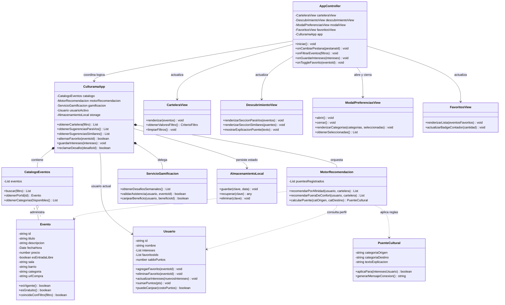

# Anexo — CULTURAMA

## Registro de Trabajo — Reunión 6

| Fecha | Participantes | Horas | Actividades Realizadas |
| :--- | :--- | :---: | :--- |
| **14/10/2026** | Nahuel Ximeno, Lautaro Moreno | 2.0 h c/u | **Reunión 6 — Documentación de Anexo y Modelo de Dominio UML:** Consolidación de este anexo (`anexo.md`) con las transcripciones completas de las 3 entrevistas exploratorias (Sofía de 20 años, Martín de 30 años y Carolina de 42 años); diseño y formalización del Diagrama de Clases UML de la aplicación (desacoplando capas de interfaz, dominio y persistencia local); integración de la sección de Modelo de Dominio dentro de `informe_1.md`; y sincronización de las ramas de desarrollo `DevNahuel` y `DevLautaro` con `main` en GitHub. |

---

## Transcripciones de Entrevistas Exploratorias

**Objetivo:** Comprender cómo personas de diferentes edades que forman parte del rango de nuestro público objetivo descubren actividades culturales en Montevideo, qué dificultades encuentran y cómo reaccionarían ante una plataforma que centraliza eventos y fomenta la exploración cultural.

Entrevista 1 — Sofia, estudiante universitaria de derecho. 20 años. Montevideo. Usuaria intensiva de redes sociales (Instagram, TikTok). Alta disponibilidad para planes de fin de semana con amigos, pero condicionada por presupuesto estudiantil y habitual a un circuito restringido de música en vivo y recitales.

Entrevistador: Para empezar, ¿me contás un poco qué hacés normalmente en tu tiempo libre?

Sofia (20 años): Y… depende. Si tengo tiempo, me junto con amigos, voy a alguna fiesta, a algún toque. También me gusta ir a tomar algo. No es que tenga una agenda armada de cosas para hacer, voy viendo.

Entrevistador: ¿Y cómo te enterás de esos eventos?

Sofia: Por Instagram, principalmente. A veces alguien sube una historia y digo “pa, pinta ir”, o me manda algo una amiga por WhatsApp. Pero buscar, tipo entrar a una página a ver qué hay, no hago mucho.

Entrevistador: ¿Te pasa enterarte de cosas cuando ya pasaron?

Sofía: Sí, un montón. Después veo las fotos y digo “pa qué demás, ni sabía que estaba eso”. Sobre todo con ferias, muestras o cosas que no son tan conocidas.

Entrevistador: ¿Sentís que terminás haciendo siempre planes parecidos?

Sofía: Sí, bastante. Porque ya sabés más o menos qué te vas a encontrar. Si vas a un lugar nuevo, tampoco sabés si va a estar bueno o si vas a gastar plata al pedo.

Entrevistador: ¿Qué te haría animarte a probar una actividad que nunca hiciste?

Sofía: Que me llame la atención, primero. Y tener un poco de información. Por ejemplo, si es una obra de teatro, saber de qué trata, cuánto dura, cuánto sale. Porque capaz pienso que el teatro es algo medio aburrido y después hay una obra que está buenísima, pero si no sé cuál es, no voy.

Entrevistador: Imaginate una aplicación que reúna eventos de Montevideo y te recomiende tanto cosas que te gustan como actividades diferentes. ¿La usarías?

Sofía: Sí, podría estar bueno. Sobre todo para los fines de semana, cuando estás con tus amigos diciendo “¿qué hacemos?” y nadie tiene idea.

Entrevistador: ¿Te gustaría que te proponga desafíos, como probar una actividad cultural nueva?

Sofía: Sí, sino es demasiado obligatorio,  que te tire una idea y, si te copa, vas. Lo de los puntos puede estar bueno si después te sirven para algo.

Entrevistador: ¿Qué tendría que mostrarte la aplicación para que te resulte útil?

Sofia: La fecha, el lugar, el precio y fotos. Y que no tenga eventos que ya terminaron. Eso sería importante, porque si entro y está todo viejo, la borro.

Entrevistador: Perfecto, muchas gracias por tu tiempo.

Sofía: Gracias a vos y mostrame cuando hagan la aplicación jaja. 

⸻

Entrevista 2 — Martin, trabaja en Montevideo. 30 años. Profesional dependiente con jornada laboral completa. Dispone de menor tiempo libre para planificar ocio; prioriza resolver planes de forma rápida y sin fricción. Tiende a repetir bares y propuestas familiares por comodidad y temor a perder tiempo en opciones inciertas.

Entrevistador: ¿Cómo solés organizar tus salidas o actividades culturales?

Martín: La verdad, bastante sobre la marcha. Laburo durante la semana y a veces llego al viernes sin haber organizado nada. Ahí veo si hay algún toque, si algún amigo propone algo o si aparece algo en Instagram.

Entrevistador: ¿Te resulta fácil encontrar opciones?

Martín: Encontrar alguna opción, sí. Encontrar varias y compararlas, no tanto. Tenés que seguir un montón de cuentas. Un lugar publica una cosa, otro publica otra, y al final terminás eligiendo lo que ya conocés.

Entrevistador: ¿Qué tipo de actividades hacés más seguido?

Martín: Música en vivo, algún bar, cine de vez en cuando. Me gustan otras cosas también, pero no necesariamente estoy pendiente de lo que hay.

Entrevistador: ¿Por qué pensás que no explorás tanto?

Entrevistado: Tiempo, principalmente. Y la comodidad tambien influye, si te soy sincero. Cuando tenés una semana complicada, querés hacer algo que sabés que va a estar bueno. No querés pasar media hora buscando.

Entrevistador: Si existiera una plataforma que centralizara la agenda cultural, ¿qué funciones te servirían?

Martin: Poder filtrar por día, por zona y por precio. Si me muestra algo para hoy a la noche, que pueda ver enseguida dónde es y cuánto sale. No tener que abrir cinco enlaces para averiguarlo.

Entrevistador: ¿Y las recomendaciones de actividades fuera de tus gustos habituales?

Martin: Me interesan, siempre que tengan algún sentido. Si escucho música electrónica y me recomendás una exposición de arte, capaz sí, pero explicame un poco por qué podría gustarme. No me pongas cualquier cosa solo para que sea diferente.

Entrevistador: ¿Qué te parecería sumar puntos por asistir a actividades nuevas?

Martin: Puede funcionar, pero para mí tiene que haber algún beneficio concreto. Un descuento, una entrada más barata, algo. Si son puntos que no sirven para nada, al principio capaz te entusiasma y después te olvidás.

Entrevistador: ¿Qué te haría dejar de usar la aplicación?

Martín: Que tenga poca oferta o que me recomiende siempre lo mismo. También si está llena de publicidad. Una cosa es que te destaque un evento y otra que parezca que todo lo que aparece está pago.

⸻

Entrevista 3 — Carolina, trabaja y vive en Montevideo. 42 años. Profesional con intereses culturales amplios y consolidados (teatro, cine, muestras históricas). Manifiesta frustración frecuente al enterarse de actividades interesantes de forma tardía, una vez finalizadas. Requiere datos logísticos completos (ubicación precisa, accesos, horarios, estacionamiento/seguridad) para coordinar salidas individuales o en pareja.

Entrevistador: ¿Qué hacés normalmente cuando querés salir o hacer alguna actividad cultural?

Carolina: Generalmente busco alguna recomendación o miro las redes. Si hay algo en un teatro o en una sala que conozco, entro directamente a ver la programación. Pero no tengo un lugar donde mire todo junto.

Entrevistador: ¿Te parece que la oferta cultural de Montevideo es fácil de conocer?

Carolina: No del todo. Yo creo que hay muchas cosas, más de las que uno piensa, pero están bastante separadas. Hay que conocer los lugares o seguir las cuentas indicadas. Si no, te perdés un montón.

Entrevistador: ¿Te ha pasado de encontrar una actividad que te hubiera gustado hacer, pero enterarte tarde?

Carolina: Sí, claro. Sobre todo exposiciones, visitas guiadas o actividades que duran pocos días. A veces me entero porque alguien comparte una foto después y pienso que me hubiera gustado ir.

Entrevistador: ¿Qué te dificulta probar actividades diferentes?

Carolina: Primero, enterarme. Después, tener información suficiente. Si veo una actividad que no conozco, quiero saber bien de qué se trata, dónde es, cuánto cuesta y si hay que reservar. No me gusta tener que andar buscando toda esa información por separado.

Entrevistador: ¿Cómo te resultaría una aplicación que reuniera esos eventos?

Carolina: Me resultaría práctica, si está bien organizada. Me gustaría poder entrar y ver qué hay esta semana, sin tener que conocer de antemano los lugares o las instituciones.

Entrevistador: ¿Te interesaría que también te sugiriera actividades fuera de tus intereses habituales?

Carolina: Sí. De hecho, me parece interesante. Pero me gustaría que fuera una sugerencia, no que la aplicación decida por mí. Podría mostrarme algo que nunca se me hubiera ocurrido buscar.

Entrevistador: ¿Qué importancia tendría para vos la confianza en la información?

Carolina: Mucha. Que los horarios estén bien, que el precio sea correcto y que el evento realmente se haga. Si voy a organizar mi tiempo para salir, necesito confiar en lo que estoy viendo.

Entrevistador: ¿Y un sistema de puntos o beneficios por descubrir actividades?

Carolina: Está bien como incentivo adicional. Si consigo un descuento, mejor. Pero creo que lo principal sería que me facilite encontrar cosas interesantes y me ahorre tiempo.

Entrevistador: Si tuvieras que elegir una sola cosa que la aplicación debería resolver, ¿cuál sería?

Carolina: Tener toda la información en un mismo lugar y poder encontrar algo que realmente me interese sin pasar tanto tiempo buscando.

### Diagrama de Clases UML

