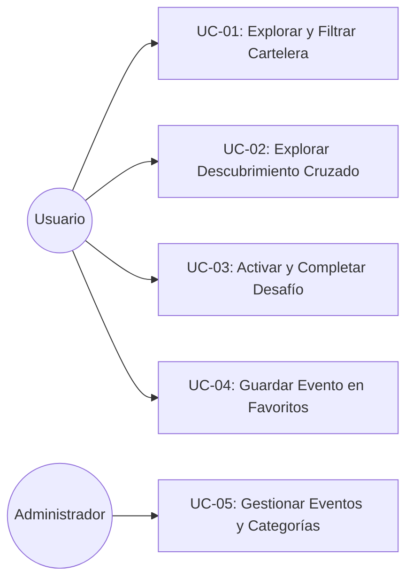
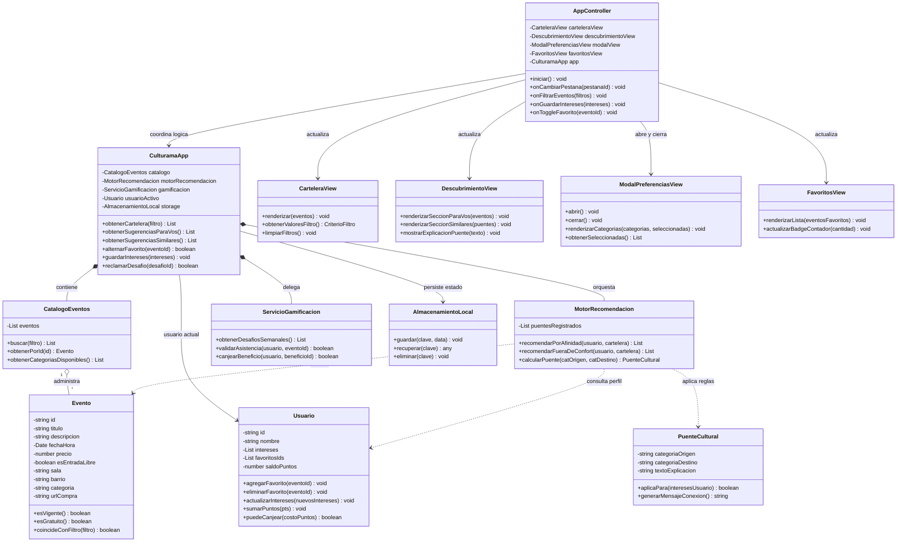
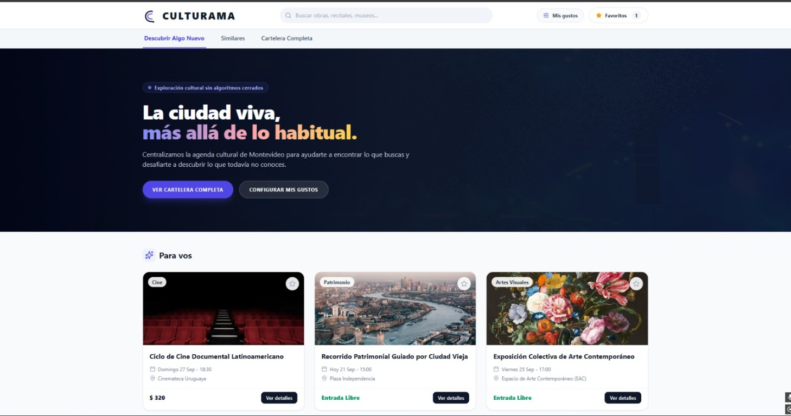
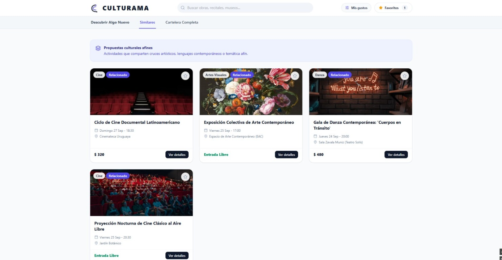
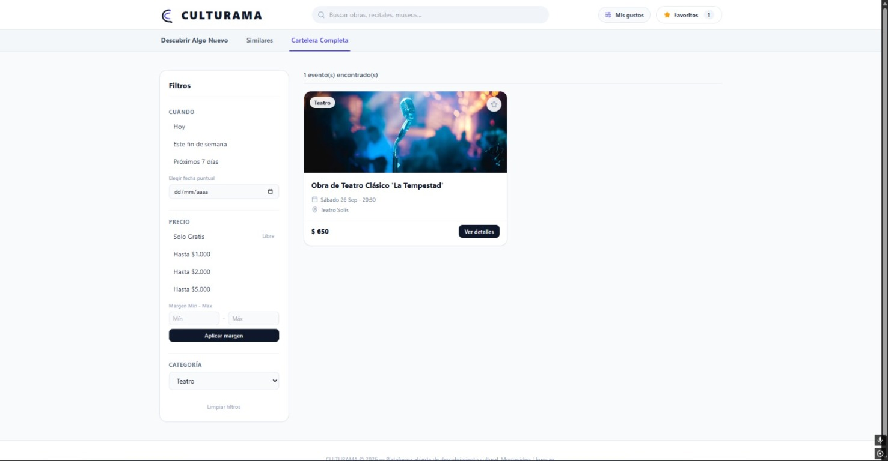
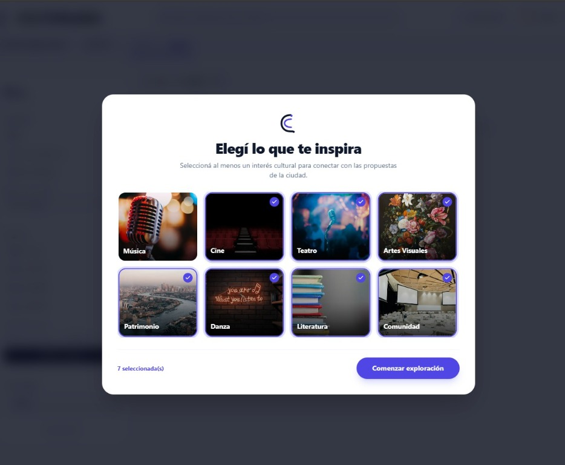
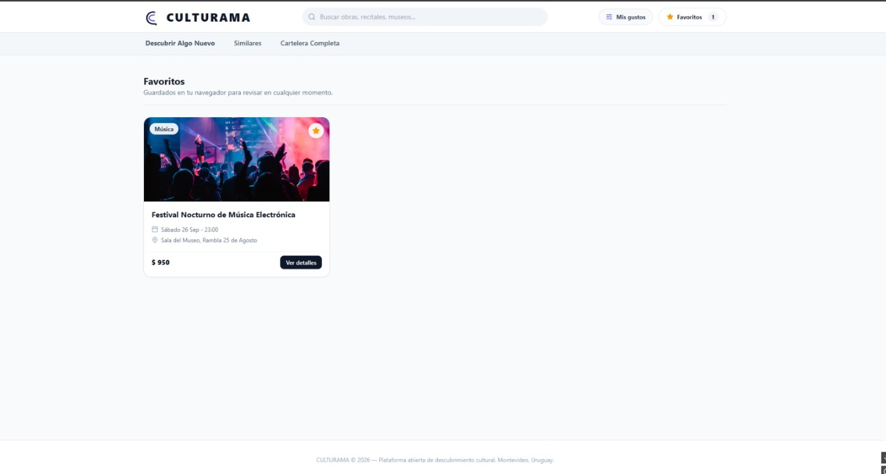

# Informe Académico 1

# Proyecto: CULTURAMA

**Plataforma de Descubrimiento Cultural Centralizado y Recomendación Fuera de la Zona de Confort**

**Integrantes:** Nahuel Ximeno, Lautaro Moreno  
**Curso:** Fundamentos de Ingeniería de Software (FIS) — 2026 Semestre 2  
**Institución:** Universidad ORT Uruguay

---

## Descripción del Trabajo Individual

A continuación se detalla la dedicación horaria y las actividades realizadas por cada integrante a lo largo del desarrollo de esta primera entrega del proyecto.

### Registro Cronológico de Actividades

| Fecha          | Participantes                 | Actividades Realizadas                                                                                                                                                                                                                                                                                                                                                                 | Horas Invertidas |
| :------------- | :---------------------------- | :------------------------------------------------------------------------------------------------------------------------------------------------------------------------------------------------------------------------------------------------------------------------------------------------------------------------------------------------------------------------------------- | :--------------: |
| **09/09/2026** | Nahuel Ximeno, Lautaro Moreno | **Reunión 1 — Ideación y Planificación:** Definición de la idea de _CULTURAMA_, análisis del problema (dispersión de eventos y repetición de planes en Montevideo), selección de los 3 segmentos de edad (20, 30 y 40 años) y armado de las preguntas para las entrevistas.                                                 |    2.5 h c/u     |
| **16/09/2026** | Nahuel Ximeno, Lautaro Moreno | **Reunión 2 — Puesta en Común de Entrevistas:** Transcripción y análisis de las 3 entrevistas realizadas (Sofía de 20 años, Martín de 30 años y Carolina de 40 años). Identificación de los problemas principales: caer siempre en lo mismo, enterarse tarde de las actividades, interés en sugerencias fuera de la rutina con puente cultural y sistema de desafíos con puntos. |    3.0 h c/u     |
| **23/09/2026** | Nahuel Ximeno, Lautaro Moreno | **Reunión 3 — Requisitos y Modelo de Dominio:** Definición y priorización de requerimientos funcionales y no funcionales con MoSCoW, redacción de User Stories (formato INVEST con criterios Dado / Cuando / Entonces), especificación de Casos de Uso y diseño del Modelo de Dominio (MER).                                   |    3.0 h c/u     |
| **29/09/2026** | Nahuel Ximeno, Lautaro Moreno | **Reunión 4 — Repositorio Git, Bocetos y Cierre:** Configuración del repositorio en GitHub, definición de ramas (`main`, `DevNahuel`, `DevLautaro`) y pautas de commits, diseño del prototipo de interfaz, verificación y validación, sección de IA, reflexión del equipo y revisión final del informe.                        |    2.5 h c/u     |
| **13/10/2026** | Nahuel Ximeno, Lautaro Moreno | **Reunión 5 — Ajustes, Formato y Refinamiento:** Revisión integral del informe, ajuste del tono de redacción para hacerlo más claro y natural, detalle explícito del uso de Gemini como LLM, reestructuración formal de los Casos de Uso bajo plantilla con secuencias normales y alternativas, e integración de la matriz de trazabilidad con los requerimientos. |    2.0 h c/u     |
| **14/10/2026** | Nahuel Ximeno, Lautaro Moreno | **Reunión 6 — Anexo de Entrevistas, Modelo UML y Sincronización:** Consolidación y estructuración del documento de anexo (`anexo.md`) con las transcripciones completas de las 3 entrevistas, especificación del Diagrama de Clases UML de la aplicación (separando capas de interfaz, dominio y persistencia local), actualización e integración de la sección de Modelo de Dominio, y sincronización de las ramas de desarrollo (`main`, `DevNahuel`, `DevLautaro`) en GitHub. |    2.0 h c/u     |

### Resumen por Integrante

| Integrante         | Horas Totales | Tareas Clave                                                                                                                                                                                |
| :----------------- | :-----------: | :------------------------------------------------------------------------------------------------------------------------------------------------------------------------------------------ |
| **Nahuel Ximeno**  |  **15.0 h**   | Ideación de CULTURAMA, diseño de cuestionarios y análisis de entrevistas, diagramación del modelo de dominio UML, setup y sincronización de Git, bocetos UI, formato de casos de uso y redacción. |
| **Lautaro Moreno** |  **15.0 h**   | Ideación de CULTURAMA, diseño de cuestionarios y análisis de entrevistas, especificación de RF/RNF con MoSCoW, redacción de User Stories, Casos de Uso, consolidación de entrevistas en anexo, matriz de trazabilidad y revisión. |

---

## Repositorio Git

### Vínculo con Conceptos de Repositorio Remoto y Local

Para el desarrollo del proyecto utilizamos **Git** como sistema de control de versiones, organizando el trabajo entre el repositorio remoto y nuestros entornos locales:

- **Repositorio Remoto (GitHub):** Alojado en la nube (`https://github.com/IngSoft-FIS-2026-2/m3a-adorjan-roll-proyecto-group-8.git`), es el punto central donde integramos el trabajo de ambos integrantes, respaldamos el proyecto y mantenemos las versiones estables para las entregas y el seguimiento del curso.
- **Repositorio Local:** Cada desarrollador mantiene una copia completa del repositorio en su máquina (`d:\escritorio\ORT\fis`). Esto nos permite avanzar de forma independiente, probar cambios y hacer commits locales sin interferir con el trabajo del compañero hasta estar listos para sincronizar.

### Estrategia de Ramas (Branching Strategy)

Para trabajar en paralelo de forma ordenada y no pisarnos los cambios, definimos el siguiente esquema de ramas:

1. **Rama `main` (Producción / Entregas):**
   - Es la rama principal del proyecto.
   - Contiene únicamente versiones terminadas y probadas que cumplen con los requisitos de cada entrega.
   - No hacemos cambios directos sobre `main`; integramos el trabajo mediante _Pull Requests_ (PR) luego de revisarlo y validarlo.

2. **Ramas de Desarrollo Individual (`DevNahuel` y `DevLautaro`):**
   - Ramas creadas a partir de `main` para que cada uno trabaje en sus tareas asignadas sin riesgo de generar conflictos en el código o la documentación compartida.
   - Cada uno trabaja en su rama propia, haciendo commits frecuentes y sincronizando (`push`/`pull`) con sus respectivas ramas remotas en GitHub (`origin/DevNahuel` y `origin/DevLautaro`).
   - Para funcionalidades puntuales de mayor tamaño, creamos ramas dedicadas bajo la convención `feature/<nombre-funcionalidad>`.

### Pautas de Commits y Acuerdos Grupales

Para mantener un historial ordenado y fácil de seguir, acordamos las siguientes pautas:

- **Convención de Mensajes de Commit:** Seguimos una convención basada en _Conventional Commits_ con prefijos claros en español según el tipo de cambio:
  - `docs:` Cambios o incorporaciones en la documentación académica (`informe_1.md`, etc.).
  - `feat:` Nuevas funcionalidades en la aplicación.
  - `fix:` Corrección de errores o defectos.
  - `refactor:` Mejoras en la estructura del código sin cambiar su comportamiento externo.
  - `style:` Ajustes visuales, de formato o estilos CSS.
  - `test:` Pruebas unitarias o de integración.
  - `chore:` Tareas rutinarias de configuración y mantenimiento (npm, linters, gitignore).
- **Atomicidad:** Cada commit resuelve un cambio puntual y claro, evitando agrupar modificaciones inconexas en una sola confirmación.
- **Claridad:** Escribimos los mensajes de forma directa, explicando qué se hizo y, si hace falta, por qué (por ejemplo, `docs: documentar entrevistas y hallazgos en informe_1.md`).
- **Sincronización Previa:** Antes de empezar una jornada de trabajo, cada integrante actualiza su rama con los últimos cambios de `main` para evitar posibles conflictos al integrar.

### Propósito y Contenido del Archivo `README.md`

El archivo `README.md` en la raíz del repositorio funciona como guía inicial y técnica del proyecto. Sus funciones principales son:

- **Presentar el Proyecto:** Explicar qué es _CULTURAMA_, su propuesta de valor y los objetivos que persigue.
- **Estructura del Proyecto:** Orientar sobre la organización de carpetas para el código (`src/domain`, `src/interface`) y la documentación académica (`docs`).
- **Instrucciones de Instalación y Uso:** Detallar los comandos para instalar paquetes y levantar el entorno local (`npm install`, `npm run dev`).
- **Scripts de Calidad y Construcción:** Indicar cómo ejecutar las herramientas de linting (`npm run lint`), formateo (`npm run format`), tests automatizados (`npm run test`) y el empaquetado final (`npm run build`).

### Organización del Repositorio y Estructura de Archivos

El repositorio está organizado separando claramente las responsabilidades y módulos del sistema:

```text
├── .git/                      # Metadatos del sistema de control de versiones Git
├── .gitignore                 # Definición de archivos y carpetas excluidas del versionado
├── README.md                  # Manual de inicio rápido y documentación técnica del repositorio
├── package.json               # Manifiesto de dependencias, scripts y metadatos del proyecto npm
├── package-lock.json          # Árbol de dependencias exacto y determinista de npm
├── tsconfig.json              # Configuración del compilador TypeScript
├── eslint.config.js           # Reglas y estándares de calidad de código y análisis estático
├── index.html                 # Punto de entrada HTML de la aplicación web
├── docs/                      # Informes académicos y documentación formal del obligatorio
│   ├── informe_1.md           # Informe Académico 1 (Investigación, Requisitos, Dominio)
│   ├── informe_2.md           # Informe Académico 2 (Diseño, Implementación y Métricas)
│   └── informe_testing.md     # Informe de Pruebas y Reporte de Calidad
└── src/                       # Código fuente de la solución CULTURAMA
    ├── domain/                # Capa de Dominio: lógica de negocio, entidades y tests asociados
    └── interface/             # Capa de Presentación: componentes visuales, controladores y estilos
```

### Comandos de Git Utilizados y su Justificación

| Comando                                     | Contexto de Uso y Justificación                                                                                             |
| :------------------------------------------ | :-------------------------------------------------------------------------------------------------------------------------- |
| `git clone <url> .`                         | Clona el repositorio remoto en la máquina local para empezar a trabajar con todo el historial del proyecto.                 |
| `git status`                                | Permite chequear qué archivos fueron modificados, cuáles están preparados para commitear y cuáles aún no tienen seguimiento. |
| `git branch <nombre>` / `git branch -a`     | Utilizado para crear ramas locales (`DevNahuel`, `DevLautaro`) y listar todas las ramas locales y remotas.                  |
| `git checkout <rama>` / `git switch <rama>` | Permite cambiar de una rama a otra para trabajar en el contexto deseado.                                                    |
| `git add <archivo>` / `git add .`           | Mueve los cambios seleccionados al área de preparación (_staging area_) antes del commit.                                   |
| `git commit -m "..."`                       | Guarda los cambios en el historial con un mensaje descriptivo que deja registro del avance.                                 |
| `git push -u origin <rama>`                 | Sube los commits locales a GitHub y asocia la rama local con su correspondiente remota.                                     |
| `git pull`                                  | Descarga e integra los cambios remotos al entorno local para mantenernos al día con el trabajo del compañero.              |
| `git log --oneline`                         | Muestra un resumen del historial cronológico para verificar qué commits se aplicaron.                                       |

---

## Investigación

### Métodos de Investigación Utilizados y Justificación

Para definir y fundamentar la propuesta de **CULTURAMA**, investigamos el problema mediante dos técnicas complementarias:

1. **Entrevistas Semiestructuradas:**
   - **Por qué las elegimos:** Nos permitieron hablar directamente con personas reales sobre cómo buscan planes en su día a día, repreguntar sobre sus frustraciones y entender por qué suelen terminar haciendo siempre lo mismo. A diferencia de una encuesta cerrada, este formato nos dio la flexibilidad de profundizar en motivos espontáneos.
   - **Muestra:** Entrevistamos a 3 personas en Montevideo de 20, 30 y 40 años para abarcar distintas etapas de vida, disponibilidad horaria, presupuestos y hábitos culturales.
2. **Revisión de Alternativas Actuales (Benchmark Exploratorio):**
   - **Por qué lo hicimos:** Analizamos los medios que la gente usa actualmente para enterarse de eventos en Montevideo (cuentas de Instagram, búsquedas en Google, carteleras de teatros y ticketeras). Confirmamos que la oferta es amplia pero está muy dispersa, y que los algoritmos de redes sociales tienden a encerrar a cada usuario en lo que ya conoce.

---

### Registro Detallado de Entrevistas

#### Entrevista 1 — Persona de 20 años

**Perfil:** Sofía, 20 años, estudiante universitaria de derecho, Montevideo. Usuaria intensiva de redes sociales (Instagram, TikTok). Alta disponibilidad para planes de fin de semana con amigos, pero condicionada por presupuesto estudiantil y habituada a un circuito restringido de música en vivo y recitales.

1. **¿Qué hacés normalmente cuando querés buscar algo para hacer en Montevideo?**  
   _Generalmente miro Instagram. Si veo que algún amigo subió algo o sigo a algún lugar que hace eventos, me entero por ahí. También a veces busco en Google, pero no tengo una página específica que use siempre._
2. **¿Sentís que te enterás de la mayoría de las cosas que pasan en la ciudad?**  
   _No, para nada. Siento que hay un montón de cosas que no me entero. Muchas veces me entero después de que pasaron._
3. **¿Qué tipo de actividades culturales hacés habitualmente?**  
   _Más que nada música, recitales, fiestas, algún festival. También cine, pero teatro o museos bastante menos._
4. **¿Por qué pensás que no vas a otros tipos de actividades?**  
   _Creo que porque directamente no me aparecen. Si no sigo una cuenta de teatro, por ejemplo, es difícil que me entere de una obra._
5. **¿Te pasa que terminás haciendo siempre cosas parecidas?**  
   _Sí. Con mis amigos terminamos yendo a lugares parecidos o haciendo planes parecidos porque ya sabemos que están buenos._
6. **Si una aplicación te mostrara actividades que normalmente no elegirías, ¿te interesaría?**  
   _Sí, pero tendría que ser algo que realmente parezca interesante. No quiero que me muestre cualquier cosa solamente porque es diferente._
7. **¿Qué información necesitarías ver para decidir si ir?**  
   _Dónde es, cuándo, cuánto sale, qué tipo de actividad es y más o menos qué onda tiene. Fotos o videos también._
8. **¿Confiarías en una aplicación que te recomienda eventos?**  
   _Sí, si veo que la información está actualizada y que los eventos son reales. También estaría bueno que otras personas puedan dejar opiniones._
9. **¿Te motivaría recibir puntos por probar actividades nuevas?**  
   _Sí, bastante. Sobre todo si después sirven para conseguir descuentos o algo gratis. Sería como un incentivo para probar cosas que normalmente no haría._
10. **¿Qué te parecería que la aplicación te diga “esto es diferente a lo que hacés habitualmente”?**  
    _Me gustaría. Incluso podría ser más interesante que solamente recomendarme cosas que ya sé que me gustan._
11. **¿Usarías una función que te proponga un desafío cultural?**  
    _Sí. Por ejemplo, “esta semana probá una obra de teatro” y que te dé puntos. Si lo hacés con amigos, incluso mejor._
12. **¿Qué tendría que tener la aplicación para que realmente la uses?**  
    _Que haya bastantes eventos y que no esté desactualizada. Si entro dos veces y no encuentro nada, probablemente no la use más._

---

#### Entrevista 2 — Persona de 30 años

**Perfil:** Martín, 30 años, trabaja en Montevideo. Profesional dependiente con jornada laboral completa. Dispone de menor tiempo libre para planificar ocio; prioriza resolver planes de forma rápida y sin fricción. Tiende a repetir bares y propuestas familiares por comodidad y temor a perder tiempo en opciones inciertas.

1. **¿Cómo te enterás de eventos o actividades para hacer?**  
   _Principalmente por Instagram, WhatsApp o amigos. También cuando veo publicidad de algún evento._
2. **¿Buscás activamente actividades o generalmente aparecen en tu entorno?**  
   _Generalmente aparecen. No suelo sentarme a buscar “qué puedo hacer esta semana”._
3. **¿Por qué?**  
   _Por falta de tiempo. Entre trabajo y otras cosas, cuando quiero hacer algo prefiero resolver rápido._
4. **¿Sentís que siempre terminás haciendo el mismo tipo de planes?**  
   _Sí. Hay determinados bares, restaurantes, recitales o fiestas a los que ya fui y sé qué esperar._
5. **¿Te interesaría descubrir actividades diferentes?**  
   _Sí, pero tiene que ser fácil. Si tengo que investigar demasiado qué es cada cosa, probablemente no._
6. **¿Qué te podría llevar a probar algo que nunca hiciste?**  
   _Que alguien me lo recomiende y que tenga suficiente información. También un descuento podría ayudar._
7. **¿Qué información considerarías indispensable?**  
   _Precio, ubicación, horario, duración y qué tipo de experiencia es. También estaría bueno saber si es algo para ir solo, en pareja o con amigos._
8. **¿Te molesta que la información sobre eventos esté repartida entre muchas cuentas y páginas?**  
   _Sí. Muchas veces tenés que entrar a Instagram, después buscar el lugar, después ver dónde comprar entradas. Está bastante fragmentado._
9. **¿Usarías una aplicación que reúna todas esas actividades?**  
   _Sí, especialmente si puedo filtrar por día, zona y precio._
10. **¿Te interesaría que además te recomiende algo fuera de tus intereses habituales?**  
    _Sí, aunque tendría que entender por qué me lo recomienda. Si me dice “te puede interesar porque te gusta X”, me genera más confianza._
11. **¿Qué opinás de un sistema de puntos por explorar diferentes categorías culturales?**  
    _Me parece interesante. Lo haría más como un juego. Si además los puntos tienen algún beneficio real, mucho mejor._
12. **¿Qué podría hacer que abandones la aplicación?**  
    _Que me recomiende siempre las mismas cosas o que tenga eventos viejos. También demasiadas notificaciones._

---

#### Entrevista 3 — Persona de 40 años

**Perfil:** Carolina, 40 años, trabaja y vive en Montevideo. Profesional con intereses culturales amplios y consolidados (teatro, cine, muestras históricas). Manifiesta frustración frecuente al enterarse de actividades interesantes de forma tardía, una vez finalizadas. Requiere datos logísticos completos (ubicación precisa, accesos, horarios, estacionamiento/seguridad) para coordinar salidas individuales o en pareja.

1. **¿Cómo buscás actividades para hacer en tu tiempo libre?**  
   _Normalmente por recomendaciones de amigos, Instagram o WhatsApp. A veces también busco directamente qué hay en determinados teatros o centros culturales._
2. **¿Te resulta fácil saber qué actividades culturales hay en Montevideo?**  
   _No siempre. Hay mucha oferta, pero está bastante dispersa._
3. **¿Qué tipo de actividades hacés habitualmente?**  
   _Me gusta ir a conciertos, teatro, cine, exposiciones y algunas actividades al aire libre._
4. **¿Hay actividades que te gustaría conocer pero a las que nunca terminás yendo?**  
   _Sí, por ejemplo algunas muestras, visitas guiadas o cosas relacionadas con la historia de Montevideo. Muchas veces las veo cuando ya pasaron._
5. **¿Qué te impide ir?**  
   _A veces no sé suficiente sobre la actividad. También el horario, el precio o dónde queda. Si no tengo claro eso, directamente no sigo buscando._
6. **¿Qué te parecería tener una aplicación que reúna actividades culturales de Montevideo?**  
   _Me parecería útil, siempre que la información sea confiable y esté actualizada._
7. **¿Qué filtros usarías?**  
   _Fecha, horario, zona, precio y tipo de actividad. También estaría bueno poder seleccionar si es para adultos, niños, pareja o amigos._
8. **¿Te gustaría que la aplicación te recomiende cosas diferentes a las que ya conocés?**  
   _Sí. De hecho creo que sería una de las cosas más interesantes, porque si solamente me recomienda lo mismo que ya busco, puedo seguir usando Instagram._
9. **¿Te molestaría que la aplicación te saque un poco de tus intereses habituales?**  
   _No, mientras pueda elegir. Me gustaría que me diga algo como “esto es diferente a lo que normalmente hacés, pero podría interesarte”._
10. **¿Qué importancia tendría para vos saber que otras personas fueron?**  
    _Bastante. Una opinión o recomendación ayuda mucho, especialmente si no conozco el lugar o la actividad._
11. **¿Te motivaría un sistema de beneficios por descubrir nuevas actividades?**  
    _Sí, pero no sería lo principal. Lo usaría como un beneficio adicional. Por ejemplo, conseguir un descuento para una entrada o un café._
12. **¿Qué tendría que pasar para que la aplicación se convierta en algo que uses habitualmente?**  
    _Que me ahorre tiempo. Si entro y puedo ver rápidamente qué hay esta semana, dónde es, cuánto cuesta y qué puede interesarme, la usaría._

---

### Hallazgos Clave que Fundamentan el Proyecto

Del análisis de las entrevistas identificamos patrones claros que fundamentan las decisiones de CULTURAMA:

1. **Información dispersa y avisos a destiempo:** Los tres participantes coincidieron en que Montevideo tiene mucha oferta cultural, pero al estar desparramada en redes, páginas web y ticketeras, muchas veces se enteran de las cosas _cuando ya pasaron_.
2. **Burbuja de intereses y rutina:** Los usuarios reconocen que tienden a repetir siempre los mismos planes. Las redes sociales solo refuerzan esto, recomendándoles únicamente cosas parecidas a las que ya siguen.
3. **Interés en salir de la rutina con una explicación clara ("Puente Cultural"):** Tuvieron muy buena recepción a la idea de probar actividades nuevas, **siempre y cuando la aplicación les explique el porqué** (ej. _“Te recomendamos esta muestra fotográfica porque te interesan los eventos de arquitectura”_).
4. **Falta de datos prácticos clave:** Si una publicación no aclara de entrada el precio, el horario exacto, el lugar o cómo sacar la entrada, la gente no pierde tiempo buscando y directamente descarta el plan.
5. **Motivación con desafíos y beneficios concretos:** Gustó mucho la propuesta de sumar puntos completando retos culturales semanales, especialmente si se pueden canjear por descuentos, 2x1 o consumiciones.

---

## RF & RNF (Requisitos Funcionales y No Funcionales)

### Técnica de Priorización: MoSCoW

Se adoptó el método **MoSCoW** para categorizar los requerimientos en función de su importancia para el valor del proyecto y la viabilidad del obligatorio:

- **Must Have (Debe tener):** Requisitos obligatorios e indispensables para que el sistema funcione y cumpla su propuesta central.
- **Should Have (Debería tener):** Requisitos de alto valor que enriquecen significativamente la experiencia del usuario, pero cuya ausencia no bloquea la entrega inicial.
- **Could Have (Podría tener):** Funcionalidades deseables de menor urgencia que se implementarán si el cronograma lo permite.
- **Won't Have (No tendrá en esta etapa):** Características postergadas conscientemente para versiones futuras del sistema.

### Requisitos Funcionales (RF)

| ID        | Requisito Funcional                                                                                                                                                                                                                                | Actor             | Prioridad MoSCoW | Justificación                                                                                                                                |
| :-------- | :------------------------------------------------------------------------------------------------------------------------------------------------------------------------------------------------------------------------------------------------- | :---------------- | :--------------: | :------------------------------------------------------------------------------------------------------------------------------------------- |
| **RF-01** | **Exploración y Filtrado Multicriterio:** El sistema debe permitir explorar eventos filtrando por fecha, rango de precios, barrio/zona de Montevideo y categoría cultural.                                                                         | Usuario           |  **Must Have**   | Resuelve el problema principal de las entrevistas: la dispersión de información y la dificultad para encontrar planes por fecha y presupuesto. |
| **RF-02** | **Ficha Detallada del Evento:** El sistema debe presentar la información logística completa de cada evento: título, descripción, fecha/horario, ubicación física con mapa, costo, organizador y enlace directo de adquisición.                     | Usuario           |  **Must Have**   | Evita que el usuario abandone la búsqueda si no encuentra rápido el precio, horario, ubicación o compra de entradas.                         |
| **RF-03** | **Taxonomía Cultural Estructurada:** El sistema debe clasificar los eventos en al menos 6 categorías principales (Música, Artes Escénicas, Audiovisual, Artes Visuales, Patrimonio y Ciudad, Cultura y Comunidad) y sus respectivas subcategorías. | Sistema / Admin   |  **Must Have**   | Permite organizar la oferta cultural y relacionar disciplinas para sugerir cruces temáticos interesantes.                                   |
| **RF-04** | **Recomendación por Afinidad Habitual:** El sistema debe sugerir eventos alineados con las preferencias e historial declarado del usuario (ej. si prefiere electrónica, sugerir eventos afines).                                                   | Usuario / Sistema |  **Must Have**   | Asegura que el usuario encuentre fácilmente lo que busca y confíe en la aplicación.                                                          |
| **RF-05** | **Descubrimiento Guiado ("Fuera de la Zona de Confort"):** El sistema debe recomendar eventos de categorías ajenas al consumo habitual del usuario, acompañados de una explicación contextualizada del motivo de la sugerencia (puente cultural).  | Usuario / Sistema |  **Must Have**   | Es la propuesta central y diferenciadora de CULTURAMA, respaldada por las entrevistas.                                                       |
| **RF-06** | **Sistema de Desafíos Culturales:** El sistema debe ofrecer misiones periódicas al usuario (ej. “Asiste a una obra de teatro independiente este mes”) asignando puntos al completarlas.                                                            | Usuario / Sistema | **Should Have**  | Gamifica la exploración y anima al usuario a probar disciplinas que no suele frecuentar.                                                     |
| **RF-07** | **Billetera de Puntos y Canje de Beneficios:** El sistema debe llevar el saldo acumulado de puntos del usuario y mostrar un catálogo de beneficios canjeables (descuentos en entradas, 2x1).                                                       | Usuario           | **Should Have**  | Le da un fin concreto a los puntos acumulados mediante beneficios y descuentos.                                                              |
| **RF-08** | **Marcado de Eventos Favoritos / Guardados:** El sistema debe permitir al usuario marcar eventos como guardados para consultarlos posteriormente en su agenda personal.                                                                            | Usuario           | **Should Have**  | Permite guardar planes de interés para revisarlos más tarde sin perderlos.                                                                   |
| **RF-09** | **Reseñas y Valoraciones Comunitarias:** El sistema debe permitir a los usuarios calificar eventos a los que asistieron y dejar breves comentarios u opiniones.                                                                                    | Usuario           |  **Could Have**  | Aporta opiniones y valoraciones de otros usuarios, factor que brinda confianza antes de ir.                                                  |
| **RF-10** | **Perfil y Gestión de Preferencias Culturales:** El sistema debe permitir al usuario configurar y modificar sus géneros e intereses de cabecera en cualquier momento.                                                                              | Usuario           | **Should Have**  | Permite al usuario ajustar sus gustos para calibrar las sugerencias.                                                                         |
| **RF-11** | **Gestión y Carga de Eventos:** El sistema debe permitir a administradores/productores registrar, editar y dar de baja eventos culturales en la cartelera.                                                                                         | Administrador     |  **Must Have**   | Indispensable para mantener la cartelera actualizada y con eventos reales.                                                                   |
| **RF-12** | **Notificaciones de Eventos Próximos:** El sistema enviará recordatorios automáticos de eventos guardados con 24 horas de antelación.                                                                                                              | Usuario           |  **Won't Have**  | Se posterga para más adelante para evitar saturar al usuario con notificaciones.                                                             |

### Requisitos No Funcionales (RNF)

| ID         | Requisito No Funcional                                                                                                                                                                                                                  | Categoría            | Métrica / Criterio de Aceptación                                                                        |
| :--------- | :-------------------------------------------------------------------------------------------------------------------------------------------------------------------------------------------------------------------------------------- | :------------------- | :------------------------------------------------------------------------------------------------------ |
| **RNF-01** | **Usabilidad y Claridad Visual:** La interfaz debe ser intuitiva, con navegación fluida, micro-animaciones y jerarquía tipográfica legible. Un usuario nuevo debe poder encontrar un evento en menos de 3 clics o menos de 30 segundos. | Usabilidad           | Medición de usabilidad con usuarios muestra (Task Success Rate > 90%).                                  |
| **RNF-02** | **Rendimiento y Tiempo de Carga:** El tiempo de respuesta inicial de la aplicación no debe superar los 2.0 segundos bajo condiciones estándar de conectividad 4G/WiFi.                                                                  | Rendimiento          | Métricas _First Contentful Paint_ (FCP) < 1.5s y _Largest Contentful Paint_ (LCP) < 2.5s en Lighthouse. |
| **RNF-03** | **Actualización y Confiabilidad de Datos:** La base de eventos debe depurar automáticamente eventos pasados y reflejar cancelaciones o cambios de horario en tiempo real.                                                               | Integridad / Calidad | No se mostrarán eventos cuya fecha/hora de finalización sea anterior a la hora local actual.            |
| **RNF-04** | **Diseño Responsivo (Cross-Device):** La aplicación web debe adaptarse con fluidez a resoluciones de dispositivos móviles (375px+), tabletas y escritorio.                                                                              | Portabilidad         | Compatibilidad verificada en navegadores modernos (Chrome, Firefox, Safari, Edge).                      |
| **RNF-05** | **Arquitectura Limpia y Modularidad:** El código fuente debe estructurarse desacoplando estrictamente el dominio del negocio (`domain`) de la interfaz (`interface`), facilitando la cobertura de pruebas unitarias.                    | Mantenibilidad       | Cobertura de tests unitarios sobre el núcleo de dominio superior al 80%.                                |
| **RNF-06** | **Seguridad y Validación de Entradas:** Todas las entradas de usuario (filtros, comentarios, perfiles) deben ser sanitizadas para evitar ataques de inyección (XSS).                                                                    | Seguridad            | Validación de esquemas y sanitización previa a la persistencia o renderizado en el DOM.                 |

---

## User Stories & Use Cases

### User Stories (US) con Criterios INVEST

#### US-01: Descubrimiento Guiado Fuera de la Zona de Confort (Prioridad: Alta — Debe tener)

- **Como** habitante de Montevideo con intereses culturales acotados (ej. únicamente música electrónica),
- **quiero** recibir recomendaciones de eventos de otras disciplinas explicándome su conexión temática o sensorial con mis gustos,
- **para** animarme a explorar nuevas experiencias culturales sin sentir que pierdo mi tiempo en actividades totalmente ajenas.
- **Criterios de Aceptación:**
  - **Escenario 1: Conexión cultural explicada**
    - _Dado_ que el usuario tiene declarada una afinidad principal por "Jazz",
    - _Cuando_ accede a la sección "Salí de tu zona de confort",
    - _Entonces_ el sistema le sugiere un documental cinematográfico sobre músicos urbanos, exhibiendo la etiqueta _"Te sugerimos esto porque disfrutás del Jazz"_.
  - **Escenario 2: Libertad de omisión**
    - _Dado_ que el usuario observa una sugerencia fuera de su zona de confort,
    - _Cuando_ presiona el botón "No me interesa ahora",
    - _Entonces_ el sistema descarta esa opción y ofrece una alternativa de otra categoría sin penalizar al usuario.

#### US-02: Búsqueda y Filtrado de Eventos (Prioridad: Alta — Debe tener)

- **Como** usuario con tiempo libre limitado,
- **quiero** filtrar la cartelera cultural por fecha, costo máximo y barrio de Montevideo,
- **para** coordinar rápidamente un plan accesible que se adapte a mi agenda sin tener que revisar decenas de páginas web.
- **Criterios de Aceptación:**
  - **Escenario 1: Filtrado exitoso**
    - _Dado_ que el usuario selecciona fecha "Fin de semana actual", zona "Ciudad Vieja" y precio "Hasta $ 500",
    - _Cuando_ aplica los filtros en la cartelera,
    - _Entonces_ el sistema lista únicamente los eventos que cumplen simultáneamente con los tres criterios.
  - **Escenario 2: Sin resultados exactos**
    - _Dado_ que no existen eventos con la combinación exacta elegida,
    - _Cuando_ se completa la búsqueda,
    - _Entonces_ el sistema informa claramente la ausencia de coincidencias y propone ampliar el radio de búsqueda o la franja horaria.

#### US-03: Desafío Cultural y Recompensas (Prioridad: Media — Debería tener)

- **Como** usuario curioso pero indeciso ante nuevas actividades,
- **quiero** activar un desafío cultural semanal que me otorgue puntos al asistir a una categoría que nunca antes experimenté,
- **para** motivarme mediante incentivos y descuentos a diversificar mis salidas habituales.
- **Criterios de Aceptación:**
  - **Escenario 1: Completar desafío y acreditar puntos**
    - _Dado_ que el usuario tiene activo el desafío _"Descubrí una muestra en el MNAV (+150 pts)"_,
    - _Cuando_ valida su asistencia al evento,
    - _Entonces_ el sistema incrementa su balance de puntos en 150 y le notifica el desbloqueo de un cupón de descuento en una cafetería cercana.

---

### Casos de Uso (Use Cases)



#### Matriz de Trazabilidad: Casos de Uso ➔ Requisitos

| Caso de Uso | Nombre | Requisitos Funcionales (RF) | Requisitos No Funcionales (RNF) |
| :--- | :--- | :--- | :--- |
| **UC-01** | Explorar y Filtrar Cartelera de Eventos | RF-01, RF-02, RF-03 | RNF-01, RNF-02, RNF-04 |
| **UC-02** | Descubrimiento Cultural Guiado ("Fuera de la Zona de Confort") | RF-03, RF-04, RF-05, RF-10 | RNF-01, RNF-02 |
| **UC-03** | Activar Desafío Cultural y Canjear Puntos | RF-06, RF-07 | RNF-01 |
| **UC-04** | Guardar Evento en Favoritos | RF-02, RF-08 | RNF-01, RNF-03 |
| **UC-05** | Gestionar Eventos y Categorías | RF-03, RF-11 | RNF-03, RNF-06 |

---

### Use Case 1

**Identificador:** UC-01

**Requerimientos asociados:** RF-01 (Exploración y Filtrado Multicriterio), RF-02 (Ficha Detallada del Evento), RF-03 (Taxonomía Cultural Estructurada), RNF-01 (Usabilidad), RNF-02 (Rendimiento)

**Nombre:** Explorar y Filtrar Cartelera de Eventos

**Descripción:** El usuario consulta la cartelera cultural aplicando filtros por fecha, precio, barrio y categoría para encontrar actividades según sus intereses y disponibilidad.

**Actores:**

- Usuario (registrado o invitado)

**Precondiciones:**

- El usuario ingresa a la plataforma CULTURAMA y existen eventos cargados en el sistema.

**Post condiciones:**

- El sistema lista los eventos coincidentes y permite visualizar la ficha con los detalles de la actividad seleccionada.

**Secuencia normal**
| # | Acción (actor) | Reacción (sistema) |
| - | ------------------------------ | ------------------------------ |
| 1 | El usuario ingresa a la pantalla de cartelera / exploración. | Muestra la lista de eventos culturales organizados por fecha y destacados. |
| 2 | El usuario selecciona filtros por fecha, zona, precio o categoría cultural. | Valida los parámetros y actualiza la vista mostrando las tarjetas de los eventos coincidentes. |
| 3 | El usuario selecciona una tarjeta de evento. | Despliega la ficha con la información completa del evento (horarios, mapa, costos y enlace de compra). |

**Secuencia alternativa**
| # | Acción (actor) | Reacción (sistema) |
| - | ------------------------------ | ------------------------------ |
| 2.1 | Si no se encuentran eventos para los filtros seleccionados | El sistema informa la falta de coincidencias y sugiere ampliar el rango de búsqueda o quitar filtros. |

---

### Use Case 2

**Identificador:** UC-02

**Requerimientos asociados:** RF-03 (Taxonomía Cultural Estructurada), RF-04 (Recomendación por Afinidad Habitual), RF-05 (Descubrimiento Guiado Fuera de Zona de Confort), RF-10 (Perfil y Preferencias), RNF-01 (Usabilidad)

**Nombre:** Descubrimiento Cultural Guiado ("Fuera de la Zona de Confort")

**Descripción:** El usuario explora sugerencias en disciplinas ajenas a su consumo habitual, visualizando la explicación del "puente cultural" para animarse a probar actividades nuevas.

**Actores:**

- Usuario registrado

**Precondiciones:**

- El usuario cuenta con un perfil con historial de afinidades o preferencias seleccionadas.

**Post condiciones:**

- El usuario visualiza propuestas fuera de su rutina con la justificación del vínculo y puede guardarlas o consultar sus detalles.

**Secuencia normal**
| # | Acción (actor) | Reacción (sistema) |
| - | ------------------------------ | ------------------------------ |
| 1 | El usuario ingresa a la sección "Descubrimiento / Fuera de tu Zona". | Analiza las categorías consumidas y selecciona eventos en disciplinas no habituales con cruces temáticos afines. |
| 2 | El usuario revisa las propuestas sugeridas. | Renderiza las tarjetas destacando la etiqueta de "Puente Cultural" y el motivo de la recomendación. |
| 3 | El usuario interactúa con la propuesta seleccionando el evento. | Muestra el detalle completo de la actividad con datos de acceso y precios. |

**Secuencia alternativa**
| # | Acción (actor) | Reacción (sistema) |
| - | ------------------------------ | ------------------------------ |
| 1.1 | Si el usuario no cuenta con historial de gustos o preferencias previas | El sistema solicita seleccionar al menos un interés inicial para calibrar las sugerencias o muestra una selección variada. |
| 2.1 | Si el usuario presiona "No me interesa ahora" en una propuesta | El sistema descarta esa sugerencia y muestra una alternativa de otra categoría. |

---

### Use Case 3

**Identificador:** UC-03

**Requerimientos asociados:** RF-06 (Sistema de Desafíos Culturales), RF-07 (Billetera de Puntos y Canje de Beneficios), RNF-01 (Usabilidad)

**Nombre:** Activar Desafío Cultural y Canjear Puntos

**Descripción:** El usuario consulta los desafíos culturales activos y canjea los puntos acumulados por beneficios concretos en entradas o consumiciones.

**Actores:**

- Usuario registrado

**Precondiciones:**

- El usuario tiene una cuenta activa y ha acumulado puntos en su billetera cultural mediante desafíos.

**Post condiciones:**

- Se descuentan los puntos del saldo del usuario y se genera un código de beneficio para su utilización.

**Secuencia normal**
| # | Acción (actor) | Reacción (sistema) |
| - | ------------------------------ | ------------------------------ |
| 1 | El usuario ingresa a la sección "Desafíos y Recompensas". | Muestra los desafíos vigentes y el catálogo de beneficios disponibles según el saldo de puntos. |
| 2 | El usuario selecciona un beneficio disponible para canjear. | Verifica que el saldo de puntos sea suficiente y solicita confirmación de la operación. |
| 3 | El usuario confirma el canje. | Deduce los puntos de la billetera y genera un código promocional único de canje. |

**Secuencia alternativa**
| # | Acción (actor) | Reacción (sistema) |
| - | ------------------------------ | ------------------------------ |
| 2.1 | Si el usuario no cuenta con puntos suficientes para el beneficio elegido | El sistema indica cuántos puntos restan y sugiere qué eventos o desafíos completar para alcanzarlos. |

---

### Use Case 4

**Identificador:** UC-04

**Requerimientos asociados:** RF-02 (Ficha Detallada del Evento), RF-08 (Marcado de Eventos Favoritos / Guardados), RNF-01 (Usabilidad), RNF-03 (Confiabilidad y Actualización)

**Nombre:** Guardar Evento en Favoritos

**Descripción:** El usuario marca un evento de su interés como guardado para tenerlo accesible rápidamente en su agenda personal sin tener que buscarlo nuevamente.

**Actores:**

- Usuario (registrado o invitado)

**Precondiciones:**

- El usuario está navegando la cartelera o las recomendaciones y visualiza un evento de su interés.

**Post condiciones:**

- El evento queda almacenado en la lista de favoritos del usuario y se actualiza el contador de la barra superior.

**Secuencia normal**
| # | Acción (actor) | Reacción (sistema) |
| - | ------------------------------ | ------------------------------ |
| 1 | El usuario presiona el botón de estrella / favorito en la tarjeta del evento. | Agrega el evento a la colección personal y resalta visualmente el estado guardado. |
| 2 | El usuario accede a la pestaña "Favoritos". | Despliega la colección de eventos guardados permitiendo consultar sus detalles o removerlos. |

**Secuencia alternativa**
| # | Acción (actor) | Reacción (sistema) |
| - | ------------------------------ | ------------------------------ |
| 1.1 | Si el evento ya se encontraba en favoritos al presionar la estrella | El sistema desmarca el evento, lo remueve de la lista de favoritos y descuenta el contador. |

---

### Use Case 5

**Identificador:** UC-05

**Requerimientos asociados:** RF-03 (Taxonomía Cultural Estructurada), RF-11 (Gestión y Carga de Eventos), RNF-03 (Actualización y Confiabilidad), RNF-06 (Seguridad y Validación)

**Nombre:** Gestionar Eventos y Categorías

**Descripción:** El administrador registra, modifica o da de baja eventos y categorías culturales para mantener la cartelera actualizada y completa.

**Actores:**

- Administrador

**Precondiciones:**

- El administrador cuenta con permisos de acceso al panel de administración del sistema.

**Post condiciones:**

- Los cambios en los eventos o categorías quedan guardados y reflejados en la plataforma para los usuarios.

**Secuencia normal**
| # | Acción (actor) | Reacción (sistema) |
| - | ------------------------------ | ------------------------------ |
| 1 | El administrador ingresa a la sección de administración de eventos. | Muestra la lista de eventos registrados y las opciones para crear, editar o eliminar. |
| 2 | El administrador completa los datos del evento (título, categoría, fecha, horario, ubicación, costo y enlace) y presiona "Guardar". | Valida los datos ingresados, persiste el evento y actualiza la cartelera. |

**Secuencia alternativa**
| # | Acción (actor) | Reacción (sistema) |
| - | ------------------------------ | ------------------------------ |
| 2.1 | Si faltan datos obligatorios o la fecha de inicio es anterior a la fecha actual | El sistema muestra los mensajes de error correspondientes y no guarda los cambios hasta su corrección. |

---

## Modelo de Dominio

Para estructurar la lógica del sistema y dar sustento a los casos de uso definidos, se diseñó el **Modelo de Clases UML de la Aplicación**, desacoplando estrictamente la interfaz de usuario (`src/interface`), el núcleo de dominio (`src/domain`) y la persistencia local en navegador (`localStorage`), en conformidad con el requisito **RNF-05**.

El detalle íntegro y su especificación exhaustiva se encuentra documentado en [anexo.md](anexo.md). A continuación se presenta el diagrama general de clases del software:



---

### Prototipo Visual e Interfaz de Usuario (UI Preview)

Para bajar a tierra los casos de uso y tener una vista previa de la experiencia de usuario antes de programar la interfaz completa, armamos un prototipo visual interactivo (**UI Preview**) de **CULTURAMA**.

> **Uso de Inteligencia Artificial en el prototipo:**  
> Para explorar ideas de diseño, combinar colores y definir la estructura del prototipo, nos apoyamos en **Google Gemini** como modelo de lenguaje (LLM). Nos sirvió para probar variantes de forma rápida antes de pasar al desarrollo de la interfaz definitiva.

A continuación se detallan las **5 pantallas y componentes centrales** que componen la interfaz de usuario de la plataforma:



*Pantalla principal / Inicio ("Descubrir Algo Nuevo").*



*Sección de descubrimiento relacionado ("Similares").*



*Cartelera completa y filtrado multicriterio.*



*Modal de calibración de preferencias ("Elegí lo que te inspira").*



*Vista de eventos guardados ("Favoritos").*

#### 1. Pantalla Principal / Inicio ("Descubrir Algo Nuevo")

- **Barra de Navegación Superior:** Logotipo e isotipo de CULTURAMA, barra de búsqueda omnibox integrada (_"Buscar obras, recitales, museos..."_), acceso directo a la configuración de intereses (_"Mis gustos"_) y acceso con badge numérico a la colección personal (_"Favoritos 1"_).
- **Pestañas de Navegación Contextual:** Selector superior de tres modos de navegación: _Descubrir Algo Nuevo_ (activa), _Similares_ y _Cartelera Completa_.
- **Hero Banner de Alto Impacto:** Diseñado con un gradiente oscuro inmersivo que enfatiza la propuesta de valor:
  - Badge distintivo: _"• Exploración cultural sin algoritmos cerrados"_.
  - Titular principal: _"La ciudad viva, más allá de lo habitual."_
  - Bajada descriptiva: _"Centralizamos la agenda cultural de Montevideo para ayudarte a encontrar lo que buscas y desafiarte a descubrir lo que todavía no conoces."_
  - Botones de acción rápida: _"VER CARTELERA COMPLETA"_ (botón primario con gradiente violeta) y _"CONFIGURAR MIS GUSTOS"_ (botón secundario estilizado).
- **Sección de Recomendación Personalizada ("Para vos"):** Fila de tarjetas dinámicas con etiqueta de disciplina, botón de favoritos directo, fotografía del evento, título, fecha/hora, sala cultural montevideana, costo (o badge verde de _"Entrada Libre"_) y botón _"Ver detalles"_:
  - _Ciclo de Cine Documental Latinoamericano_ (Cine — Cinemateca Uruguaya, Domingo 27 Sep - 18:30 — $ 320).
  - _Recorrido Patrimonial Guiado por Ciudad Vieja_ (Patrimonio — Plaza Independencia, Hoy 21 Sep - 15:00 — Entrada Libre).
  - _Exposición Colectiva de Arte Contemporáneo_ (Artes Visuales — Espacio de Arte Contemporáneo EAC, Viernes 25 Sep - 17:00 — Entrada Libre).

#### 2. Sección de Descubrimiento Relacionado ("Similares")

- **Pestaña Activa:** _Similares_.
- **Banner de Vínculo Cultural:** Alerta contextual destacada en fondo suave que explicita la lógica del motor de recomendación:  
  _“Propuestas culturales afines — Actividades que comparten cruces artísticos, lenguajes contemporáneos o temática afín.”_
- **Grilla de Descubrimiento Cruzado:** Tarjetas que incorporan una etiqueta doble: la categoría de origen y el badge distintivo _"Relacionado"_ en azul eléctrico, materializando el concepto de "puente cultural" validado en la investigación:
  - _Ciclo de Cine Documental Latinoamericano_ (Cine / Relacionado — $ 320).
  - _Exposición Colectiva de Arte Contemporáneo_ (Artes Visuales / Relacionado — Entrada Libre).
  - _Gala de Danza Contemporánea: 'Cuerpos en Tránsito'_ (Danza / Relacionado — Sala Zavala Muniz, Teatro Solís — Jueves 24 Sep - 20:00 — $ 480).
  - _Proyección Nocturna de Cine Clásico al Aire Libre_ (Cine / Relacionado — Jardín Botánico — Viernes 25 Sep - 20:30 — Entrada Libre).

#### 3. Cartelera Completa y Filtrado Multicriterio

- **Pestaña Activa:** _Cartelera Completa_.
- **Barra Lateral de Filtros (Sidebar):** Organizada en tres bloques jerárquicos que resuelven las necesidades expresadas por los usuarios con poco tiempo de búsqueda:
  - **Cuándo:** Filtros rápidos de un clic (_"Hoy"_, _"Este fin de semana"_, _"Próximos 7 días"_) junto con un selector de fecha puntual mediante control de calendario (_dd/mm/aaaa_).
  - **Precio:** Opciones predefinidas (_"Solo Gratis"_, _"Hasta $1.000"_, _"Hasta $2.000"_, _"Hasta $5.000"_) y selector de rango personalizado con campos _Mín - Máx_ y botón _"Aplicar margen"_.
  - **Categoría:** Menú desplegable selector de disciplinas (Teatro, Música, Cine, etc.) y botón _"Limpiar filtros"_.
- **Área de Resultados:** Encabezado con contador reactivo de eventos (_"1 evento(s) encontrado(s)"_) y renderizado de tarjetas filtradas (ej. _Obra de Teatro Clásico 'La Tempestad'_ en Teatro Solís, Sábado 26 Sep - 20:30, $ 650).

#### 4. Modal de Calibración de Preferencias ("Elegí lo que te inspira")

- **Acceso y Comportamiento:** Ventana modal superpuesta con desenfoque de fondo (_backdrop blur_), desplegada al presionar _"Mis gustos"_ o el botón de onboarding del banner principal.
- **Encabezado:** Monograma de CULTURAMA, título _"Elegí lo que te inspira"_ y consigna de ayuda: _"Seleccioná al menos un interés cultural para conectar con las propuestas de la ciudad."_
- **Grilla Interactiva de Categorías:** 8 tarjetas visuales con fotografías de alta calidad y tildes de selección activos:
  1. Música
  2. Cine (seleccionada)
  3. Teatro (seleccionada)
  4. Artes Visuales (seleccionada)
  5. Patrimonio (seleccionada)
  6. Danza (seleccionada)
  7. Literatura (seleccionada)
  8. Comunidad (seleccionada)
- **Barra Inferior de Acción:** Contador en tiempo real (_"7 seleccionada(s)"_) y botón de confirmación _"Comenzar exploración"_.

#### 5. Vista de Eventos Guardados ("Favoritos")

- **Acceso:** Accesible desde el botón superior _"Favoritos 1"_.
- **Encabezado:** Título de sección _"Favoritos"_ con bajada explicativa: _"Guardados en tu navegador para revisar en cualquier momento."_
- **Tarjeta de Evento Guardado:** Exhibe eventos marcados con estrella dorada activa (ej. _Festival Nocturno de Música Electrónica_ — Sala del Museo, Rambla 25 de Agosto — Sábado 26 Sep - 23:00 — $ 950), permitiendo consultar rápidamente detalles sin volver a buscar.

---

## Verificación y Validación

### Verificación

Revisamos que los requerimientos y artefactos del proyecto estuvieran bien definidos, completos y alineados con las pautas del curso:

- **Checklist de Requisitos:** Verificamos que cada requisito funcional y no funcional estuviera identificado con un código único, redactado sin ambigüedades y con su prioridad justificada mediante MoSCoW.
- **Criterios INVEST en User Stories:**
  - **I (Independientes):** Cada historia puede desarrollarse y probarse por separado sin bloqueos con las demás.
  - **N (Negociables):** Definen el valor esperado para el usuario, dejando margen para ajustar detalles técnicos durante el desarrollo.
  - **V (Valiosas):** Aportan un beneficio directo y concreto al usuario final (ahorrar tiempo, descubrir actividades nuevas, sumar puntos).
  - **E (Estimables):** Tienen un alcance acotado y viable para desarrollar entre los dos integrantes del equipo.
  - **S (Small / Pequeñas):** Son lo suficientemente chicas para completarse dentro de una iteración de trabajo.
  - **T (Testeables):** Cuentan con criterios de aceptación claros en formato _Dado / Cuando / Entonces_ para verificar su funcionamiento.

### Validación

Comprobamos si las soluciones propuestas para CULTURAMA responden efectivamente a los problemas reales detectados en las entrevistas:

- **Contraste con las entrevistas:**
  - _Sofía (20 años):_ El sistema de desafíos y puntos responde a su necesidad de tener un incentivo concreto para animarse a probar teatro o danza en vez de repetir salidas.
  - _Martín (30 años):_ Los filtros rápidos por precio, zona y horario resuelven su falta de tiempo para buscar opciones en la semana.
  - _Carolina (40 años):_ La cartelera centralizada y las recomendaciones explicadas resuelven su queja de enterarse tarde y le dan confianza para probar cosas nuevas.
- **Relación Problema ➔ Solución:**
  - _Problema:_ Información desparramada en redes sociales ➔ **Solución:** RF-01, RF-02, RF-03 (Catálogo unificado y filtrado por zona/fecha).
  - _Problema:_ Quedarse siempre en lo mismo por los algoritmos ➔ **Solución:** RF-05 (Recomendaciones fuera de la zona de confort con puente cultural).
  - _Problema:_ Falta de incentivo para probar disciplinas desconocidas ➔ **Solución:** RF-06, RF-07 (Desafíos y canje de puntos).

---

## Uso de Herramientas de IA

Durante esta primera etapa del proyecto usamos herramientas de Inteligencia Artificial Generativa como apoyo de trabajo, manteniendo siempre la autoría y el criterio propio en cada decisión:

- **Herramientas utilizadas:** Como modelo de lenguaje principal (LLM) utilizamos **Google Gemini**, complementado con herramientas de asistencia visual para el armado del prototipo.
- **En qué la aplicamos:**
  - **Diseño y prototipo de UI:** Nos apoyamos en Gemini para maquetar y estructurar el prototipo interactivo de CULTURAMA, evaluando combinaciones de colores, tipografías y ordenando los componentes principales (home, recomendaciones, cartelera completa, preferencias y favoritos).
  - **Redacción y estructura del informe:** Usamos la herramienta para revisar la claridad de las explicaciones, pulir la redacción y organizar las secciones del documento.
  - **Diagramación:** Apoyo en la generación de código Mermaid para los diagramas de casos de uso y modelo de dominio.
- **Buenas prácticas y control humano:**
  - **Revisión y validación propia:** Ningún texto, diagrama o componente visual se incorporó sin que Nahuel Ximeno y Lautaro Moreno lo revisáramos, adaptáramos y validáramos críticamente.
  - **Autoría del proyecto:** La idea de CULTURAMA, la realización presencial de las entrevistas y las decisiones sobre qué requisitos incluir son de total autoría del equipo.

---

## Reflexión

### Dinámica de Trabajo y Comunicación

Como equipo de dos personas (Nahuel Ximeno y Lautaro Moreno), mantuvimos una comunicación fluida a través de 6 reuniones de trabajo (presenciales y virtuales) y coordinación frecuente. Siempre trabajamos de forma conjunta y a la par, dedicando exactamente las mismas horas en cada etapa (15 horas en total cada uno), participando ambos tanto en las entrevistas y el análisis como en la definición de requisitos, el diseño del modelo de dominio UML, la configuración y sincronización de Git y las sesiones de ajuste y refinamiento del informe y anexo.

### Dificultades y Desafíos Encontrados

- **Acotar el alcance inicial:** Al principio pensamos en funciones de bastante complejidad (como venta directa de entradas con pasarelas de pago o geolocalización en tiempo real con GPS). Usar la técnica MoSCoW fue fundamental para descartar lo que no era prioritario y enfocarnos en el valor diferencial: **el descubrimiento guiado fuera de la zona de confort**.
- **Lograr recomendaciones equilibradas:** Un punto clave fue evitar sugerir cosas tan lejanas que generaran rechazo en el usuario. Aprendimos que el concepto de "puente cultural" (explicar la conexión entre lo conocido y la nueva disciplina) es indispensable para que la recomendación sea atractiva.

### Qué Funcionó Bien y Qué No

- **Lo que funcionó bien:** Las entrevistas a personas de diferentes edades nos dieron una base real sobre cómo se busca y consume cultura en Montevideo, evitando que tomáramos decisiones basadas en suposiciones. También nos sirvió mucho organizar el repositorio Git desde el inicio (`main`, `DevNahuel`, `DevLautaro`), lo que nos permitió avanzar en paralelo sin pisarnos el trabajo.
- **Aspectos a mejorar:** Transcribir y analizar las entrevistas nos llevó más tiempo del esperado, lo que nos dejó con menos margen para cerrar el modelo de dominio hacia el final. Para las próximas entregas vamos a planificar mejor los tiempos de estas tareas cualitativas.

### Lecciones Aprendidas

Esta primera etapa nos dejó en claro que el desarrollo de software empieza mucho antes de programar. Entender a fondo los problemas reales de los usuarios y aplicar herramientas claras (como MoSCoW, historias INVEST y modelos de dominio) nos ayudó a transformar una idea abstracta en un proyecto concreto, ordenado y listo para ser desarrollado.
