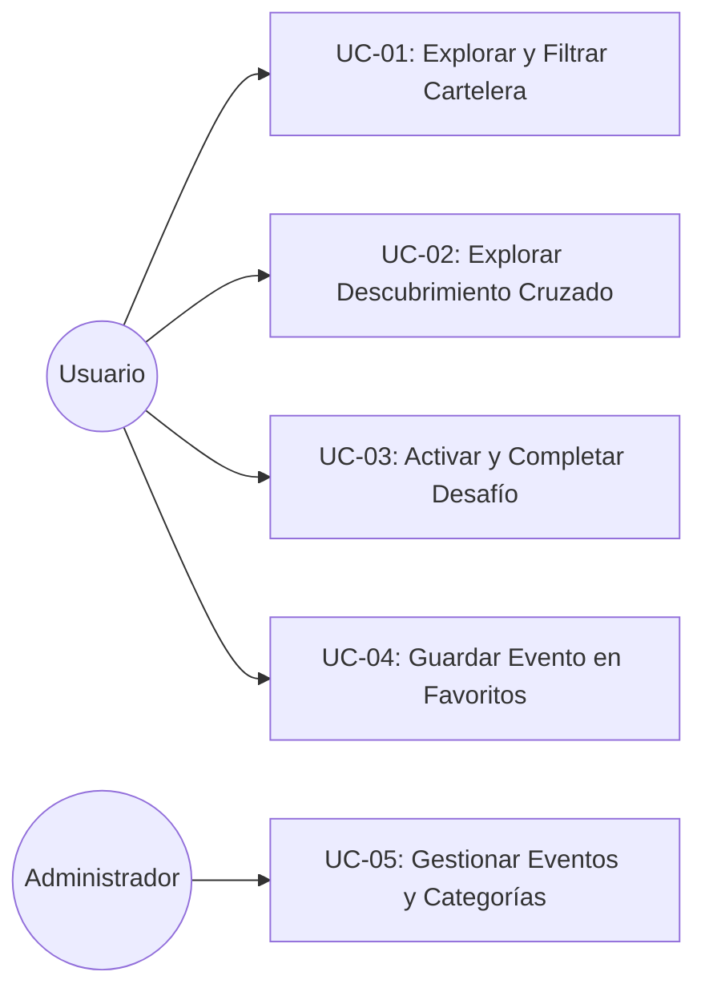

# Informe Académico 1

# Proyecto: CULTURAMA

**Plataforma de Descubrimiento Cultural Centralizado y Recomendación Fuera de la Zona de Confort**

**Integrantes:** Nahuel Ximeno, Lautaro Moreno  
**Curso:** Fundamentos de Ingeniería de Software (FIS) — 2026 Semestre 2  
**Institución:** Universidad ORT Uruguay

---

## Descripción del Trabajo Individual

A continuación se detalla la dedicación horaria y las actividades realizadas por cada integrante a lo largo del desarrollo de esta primera entrega del proyecto.

### Registro Cronológico de Actividades

| Fecha          | Participantes                 | Actividades Realizadas                                                                                                                                                                                                                                                                                                                                                                 | Horas Invertidas |
| :------------- | :---------------------------- | :------------------------------------------------------------------------------------------------------------------------------------------------------------------------------------------------------------------------------------------------------------------------------------------------------------------------------------------------------------------------------------- | :--------------: |
| **09/09/2026** | Nahuel Ximeno, Lautaro Moreno | **Reunión 1 — Ideación y Planificación de Investigación:** Definición de la propuesta de valor de _CULTURAMA_, formulación de hipótesis del problema (dispersión cultural y filtro burbuja en Montevideo), delimitación de los 3 segmentos etarios (20, 30 y 40 años) y elaboración del cuestionario de 12 preguntas para entrevistas.                                                 |    2.5 h c/u     |
| **16/09/2026** | Nahuel Ximeno, Lautaro Moreno | **Reunión 2 — Puesta en Común y Análisis de Entrevistas:** Desgrabación y triangulación de las 3 entrevistas realizadas (Sofía de 20 años, Martín de 30 años y Carolina de 40 años). Identificación de dolores clave: encierro algorítmico, enterarse tarde de eventos, validación del "puente cultural" y gamificación con puntos/desafíos.                                           |    3.0 h c/u     |
| **23/09/2026** | Nahuel Ximeno, Lautaro Moreno | **Reunión 3 — Especificación de Requisitos y Dominio:** Definición y priorización de Requisitos Funcionales y No Funcionales mediante la técnica MoSCoW, redacción de User Stories bajo formato INVEST con criterios de aceptación estructurados (Dado / Cuando / Entonces), especificación de Casos de Uso y diseño conceptual del Modelo de Dominio (Modelo Entidad-Relación - MER). |    3.0 h c/u     |
| **29/09/2026** | Nahuel Ximeno, Lautaro Moreno | **Reunión 4 — Repositorio Git, Bocetos UI y Cierre de Entrega:** Configuración del repositorio local/remoto en GitHub, ramas de trabajo (`main`, `DevNahuel`, `DevLautaro`), pautas de commits, diseño de wireframes de interfaz, verificación y validación, sección de IA, balance reflexivo y revisión final del informe.                                                            |    2.5 h c/u     |

### Resumen por Integrante

| Integrante         | Horas Totales | Tareas Clave                                                                                                                                                                                |
| :----------------- | :-----------: | :------------------------------------------------------------------------------------------------------------------------------------------------------------------------------------------ |
| **Nahuel Ximeno**  |  **11.0 h**   | Ideación de CULTURAMA, diseño de cuestionarios y análisis de entrevistas, diagramación del modelo de dominio, setup y gestión del repositorio Git, bocetos UI y redacción del informe.      |
| **Lautaro Moreno** |  **11.0 h**   | Ideación de CULTURAMA, diseño de cuestionarios y análisis de entrevistas, especificación de RF/RNF con MoSCoW, redacción de User Stories (INVEST), Casos de Uso y validación de requisitos. |

---

## Repositorio Git

### Vínculo con Conceptos de Repositorio Remoto y Local

Durante el ciclo de desarrollo de software se implementó un flujo de trabajo basado en el sistema de control de versiones distribuido **Git**, articulando los siguientes conceptos fundamentales:

- **Repositorio Remoto (GitHub):** Alojado en la plataforma en la nube (`https://github.com/IngSoft-FIS-2026-2/m3a-adorjan-roll-proyecto-group-8.git`), actúa como la fuente canónica y centralizada de la verdad del proyecto (_Single Source of Truth_). Su propósito es centralizar las versiones estables, respaldar los artefactos de desarrollo, permitir la integración del trabajo colaborativo de ambos integrantes y servir como base para el seguimiento académico y las revisiones por parte del equipo docente.
- **Repositorio Local:** Cada desarrollador mantiene una copia completa y autónoma del repositorio en su estación de trabajo local (`d:\escritorio\ORT\fis`). Esta arquitectura permite trabajar de manera desconectada, consultar el historial completo de versiones de forma inmediata, crear ramas experimentales y registrar cambios mediante commits locales sin afectar el flujo de trabajo del compañero hasta que los cambios estén listos para ser compartidos.

### Estrategia de Ramas (Branching Strategy)

Para asegurar la estabilidad del proyecto y el aislamiento de responsabilidades se adoptó un modelo de ramificación adaptado a un equipo de dos desarrolladores:

1. **Rama `main` (Producción / Entregas):**
   - Es la rama principal y protegida.
   - Contiene únicamente versiones estables, validadas y documentadas que cumplen con la totalidad de los criterios de aceptación y calidad.
   - No se realizan modificaciones directas sobre `main`. La integración se realiza mediante _Pull Requests_ (PR) una vez que las funcionalidades o documentos han sido revisados y testeados.

2. **Ramas de Desarrollo Individual (`DevNahuel` y `DevLautaro`):**
   - Ramas dedicadas creadas a partir de `main` para que cada integrante elabore sus tareas asignadas sin riesgo de generar colisiones ni estados inconsistentes en el código o la documentación compartida.
   - Cada desarrollador trabaja en su rama propia, realizando commits atómicos frecuentes y sincronizando (`push`/`pull`) con sus respectivas ramas remotas de seguimiento en GitHub (`origin/DevNahuel` y `origin/DevLautaro`).
   - Para la incorporación de nuevas características específicas de mayor envergadura, se prevé la creación de sub-ramas bajo la convención `feature/<nombre-funcionalidad>`.

### Pautas de Commits y Acuerdos Grupales

Para mantener un historial de cambios legible, trazable y estructurado, el equipo acordó las siguientes pautas de trabajo:

- **Convención de Mensajes de Commit:** Se sigue una convención estandarizada en español inspirada en _Conventional Commits_, estructurada con un prefijo semántico que define el propósito del cambio:
  - `docs:` Cambios o incorporaciones en la documentación académica (`informe_1.md`, etc.).
  - `feat:` Incorporación de una nueva funcionalidad en la aplicación.
  - `fix:` Corrección de un defecto o bug reportado.
  - `refactor:` Reestructuración del código fuente sin alterar el comportamiento observable.
  - `style:` Modificaciones visuales, de formato o estilos CSS.
  - `test:` Adición o modificación de pruebas unitarias o de integración.
  - `chore:` Tareas rutinarias de configuración (ej. npm, linters, gitignore).
- **Atomicidad:** Cada commit debe representar un cambio lógico único y autocontenido. Se evitan commits masivos o que agrupen modificaciones inconexas.
- **Tono y Claridad:** Los mensajes se redactan en imperativo o presente, explicando brevemente _qué_ se hizo y, de ser necesario, _por qué_ (ej. `docs: documentar entrevistas y hallazgos en informe_1.md`).
- **Sincronización Previa:** Antes de comenzar una jornada de trabajo, cada integrante debe actualizar su rama con los últimos cambios de `main` para minimizar divergencias y resolver conflictos de forma temprana.

### Propósito y Contenido del Archivo `README.md`

El archivo `README.md` situado en la raíz del repositorio cumple el rol de carta de presentación y guía técnica esencial del proyecto. Sus funciones principales son:

- **Descripción del Proyecto:** Presentar la propuesta de valor de _CULTURAMA_, su contexto y sus objetivos principales.
- **Estructura de Directorios:** Orientar a desarrolladores y evaluadores sobre la distribución del código (`src/domain`, `src/interface`) y la documentación (`docs`).
- **Instrucciones de Instalación y Ejecución:** Detallar los comandos necesarios para poner en marcha el entorno local (`npm install`, `npm run dev`).
- **Scripts de Calidad y Construcción:** Explicar cómo correr las herramientas de linting (`npm run lint`), formateo (`npm run format`), suites de pruebas automatizadas (`npm run test`) y empaquetado para producción (`npm run build`).

### Organización del Repositorio y Estructura de Archivos

El repositorio está estructurado siguiendo los principios de separación de responsabilidades y modularidad:

```text
├── .git/                      # Metadatos del sistema de control de versiones Git
├── .gitignore                 # Definición de archivos y carpetas excluidas del versionado
├── README.md                  # Manual de inicio rápido y documentación técnica del repositorio
├── package.json               # Manifiesto de dependencias, scripts y metadatos del proyecto npm
├── package-lock.json          # Árbol de dependencias exacto y determinista de npm
├── tsconfig.json              # Configuración del compilador TypeScript
├── eslint.config.js           # Reglas y estándares de calidad de código y análisis estático
├── index.html                 # Punto de entrada HTML de la aplicación web
├── docs/                      # Informes académicos y documentación formal del obligatorio
│   ├── informe_1.md           # Informe Académico 1 (Investigación, Requisitos, Dominio)
│   ├── informe_2.md           # Informe Académico 2 (Diseño, Implementación y Métricas)
│   └── informe_testing.md     # Informe de Pruebas y Reporte de Calidad
└── src/                       # Código fuente de la solución CULTURAMA
    ├── domain/                # Capa de Dominio: lógica de negocio, entidades y tests asociados
    └── interface/             # Capa de Presentación: componentes visuales, controladores y estilos
```

### Comandos de Git Utilizados y su Justificación

| Comando                                     | Contexto de Uso y Justificación                                                                                                                                            |
| :------------------------------------------ | :------------------------------------------------------------------------------------------------------------------------------------------------------------------------- |
| `git clone <url> .`                         | Clona el repositorio remoto directamente en la carpeta local de trabajo, permitiendo inicializar el espacio de trabajo conservando el historial y la configuración remota. |
| `git status`                                | Permite verificar en cualquier momento el estado actual del árbol de trabajo, identificando archivos modificados, en staging o sin seguimiento (_untracked_).              |
| `git branch <nombre>` / `git branch -a`     | Utilizado para crear las ramas de trabajo individual (`DevNahuel` y `DevLautaro`) y auditar la totalidad de ramas locales y remotas.                                       |
| `git checkout <rama>` / `git switch <rama>` | Permite alternar entre contextos de trabajo y ubicarse en la rama deseada antes de realizar ediciones o pruebas.                                                           |
| `git add <archivo>` / `git add .`           | Mueve las modificaciones seleccionadas desde el espacio de trabajo local hacia el área de preparación (_staging area_), preparando la confirmación del commit.             |
| `git commit -m "..."`                       | Crea un punto de control inmutable en el historial con un mensaje descriptivo que certifica la autoría y el propósito del cambio.                                          |
| `git push -u origin <rama>`                 | Publica los commits de la rama local hacia GitHub y configura el enlace de seguimiento permanente (_upstream tracking_) entre ramas homónimas.                             |
| `git pull`                                  | Descarga e integra los cambios del repositorio remoto al entorno local, manteniendo sincronizado el estado del proyecto con el del equipo.                                 |
| `git log --oneline`                         | Inspecciona el historial cronológico resumido para verificar la trazabilidad y la correcta aplicación de commits.                                                          |

---

## Investigación

### Métodos de Investigación Utilizados y Justificación

Para fundamentar el diseño de **CULTURAMA** se adoptó un enfoque metodológico mixto con preponderancia cualitativa:

1. **Entrevistas Semiestructuradas en Profundidad:**
   - **Justificación:** Es la técnica por excelencia para explorar percepciones subjetivas, motivaciones subyacentes, hábitos cotidianos y puntos de dolor en el consumo de ocio y cultura. A diferencia de un cuestionario cerrado, la entrevista semiestructurada permite repreguntar ante respuestas reveladoras y profundizar en las causas de por qué un usuario deja de asistir a actividades fuera de su rutina.
   - **Muestreo:** Se seleccionaron 3 perfiles residentes en Montevideo que cubren los segmentos objetivo del producto (20, 30 y 40 años), asegurando diversidad en disponibilidad horaria, ingresos, hábitos digitales y responsabilidades cotidianas.
2. **Análisis de Alternativas y Brecha de Mercado (Benchmark Exploratorio):**
   - **Justificación:** Se analizó el ecosistema actual mediante el cual se difunden eventos en Montevideo (cuentas de Instagram, búsquedas genéricas en Google, sitios web de salas y ticketeras). Se verificó la hipótesis de que la oferta existe en gran volumen pero sufre de una severa dispersión y sufre el fenómeno del "filtro burbuja" impuesto por los algoritmos de redes sociales.

---

### Registro Detallado de Entrevistas

#### Entrevista 1 — Persona de 20 años

**Perfil:** Sofía, 20 años, estudiante universitaria de derecho, Montevideo. Usuaria intensiva de redes sociales (Instagram, TikTok). Alta disponibilidad para planes de fin de semana con amigos, pero condicionada por presupuesto estudiantil y habituada a un circuito restringido de música en vivo y recitales.

1. **¿Qué hacés normalmente cuando querés buscar algo para hacer en Montevideo?**  
   _Generalmente miro Instagram. Si veo que algún amigo subió algo o sigo a algún lugar que hace eventos, me entero por ahí. También a veces busco en Google, pero no tengo una página específica que use siempre._
2. **¿Sentís que te enterás de la mayoría de las cosas que pasan en la ciudad?**  
   _No, para nada. Siento que hay un montón de cosas que no me entero. Muchas veces me entero después de que pasaron._
3. **¿Qué tipo de actividades culturales hacés habitualmente?**  
   _Más que nada música, recitales, fiestas, algún festival. También cine, pero teatro o museos bastante menos._
4. **¿Por qué pensás que no vas a otros tipos de actividades?**  
   _Creo que porque directamente no me aparecen. Si no sigo una cuenta de teatro, por ejemplo, es difícil que me entere de una obra._
5. **¿Te pasa que terminás haciendo siempre cosas parecidas?**  
   _Sí. Con mis amigos terminamos yendo a lugares parecidos o haciendo planes parecidos porque ya sabemos que están buenos._
6. **Si una aplicación te mostrara actividades que normalmente no elegirías, ¿te interesaría?**  
   _Sí, pero tendría que ser algo que realmente parezca interesante. No quiero que me muestre cualquier cosa solamente porque es diferente._
7. **¿Qué información necesitarías ver para decidir si ir?**  
   _Dónde es, cuándo, cuánto sale, qué tipo de actividad es y más o menos qué onda tiene. Fotos o videos también._
8. **¿Confiarías en una aplicación que te recomienda eventos?**  
   _Sí, si veo que la información está actualizada y que los eventos son reales. También estaría bueno que otras personas puedan dejar opiniones._
9. **¿Te motivaría recibir puntos por probar actividades nuevas?**  
   _Sí, bastante. Sobre todo si después sirven para conseguir descuentos o algo gratis. Sería como un incentivo para probar cosas que normalmente no haría._
10. **¿Qué te parecería que la aplicación te diga “esto es diferente a lo que hacés habitualmente”?**  
    _Me gustaría. Incluso podría ser más interesante que solamente recomendarme cosas que ya sé que me gustan._
11. **¿Usarías una función que te proponga un desafío cultural?**  
    _Sí. Por ejemplo, “esta semana probá una obra de teatro” y que te dé puntos. Si lo hacés con amigos, incluso mejor._
12. **¿Qué tendría que tener la aplicación para que realmente la uses?**  
    _Que haya bastantes eventos y que no esté desactualizada. Si entro dos veces y no encuentro nada, probablemente no la use más._

---

#### Entrevista 2 — Persona de 30 años

**Perfil:** Martín, 30 años, trabaja en Montevideo. Profesional dependiente con jornada laboral completa. Dispone de menor tiempo libre para planificar ocio; prioriza resolver planes de forma rápida y sin fricción. Tiende a repetir bares y propuestas familiares por comodidad y temor a perder tiempo en opciones inciertas.

1. **¿Cómo te enterás de eventos o actividades para hacer?**  
   _Principalmente por Instagram, WhatsApp o amigos. También cuando veo publicidad de algún evento._
2. **¿Buscás activamente actividades o generalmente aparecen en tu entorno?**  
   _Generalmente aparecen. No suelo sentarme a buscar “qué puedo hacer esta semana”._
3. **¿Por qué?**  
   _Por falta de tiempo. Entre trabajo y otras cosas, cuando quiero hacer algo prefiero resolver rápido._
4. **¿Sentís que siempre terminás haciendo el mismo tipo de planes?**  
   _Sí. Hay determinados bares, restaurantes, recitales o fiestas a los que ya fui y sé qué esperar._
5. **¿Te interesaría descubrir actividades diferentes?**  
   _Sí, pero tiene que ser fácil. Si tengo que investigar demasiado qué es cada cosa, probablemente no._
6. **¿Qué te podría llevar a probar algo que nunca hiciste?**  
   _Que alguien me lo recomiende y que tenga suficiente información. También un descuento podría ayudar._
7. **¿Qué información considerarías indispensable?**  
   _Precio, ubicación, horario, duración y qué tipo de experiencia es. También estaría bueno saber si es algo para ir solo, en pareja o con amigos._
8. **¿Te molesta que la información sobre eventos esté repartida entre muchas cuentas y páginas?**  
   _Sí. Muchas veces tenés que entrar a Instagram, después buscar el lugar, después ver dónde comprar entradas. Está bastante fragmentado._
9. **¿Usarías una aplicación que reúna todas esas actividades?**  
   _Sí, especialmente si puedo filtrar por día, zona y precio._
10. **¿Te interesaría que además te recomiende algo fuera de tus intereses habituales?**  
    _Sí, aunque tendría que entender por qué me lo recomienda. Si me dice “te puede interesar porque te gusta X”, me genera más confianza._
11. **¿Qué opinás de un sistema de puntos por explorar diferentes categorías culturales?**  
    _Me parece interesante. Lo haría más como un juego. Si además los puntos tienen algún beneficio real, mucho mejor._
12. **¿Qué podría hacer que abandones la aplicación?**  
    _Que me recomiende siempre las mismas cosas o que tenga eventos viejos. También demasiadas notificaciones._

---

#### Entrevista 3 — Persona de 40 años

**Perfil:** Carolina, 40 años, trabaja y vive en Montevideo. Profesional con intereses culturales amplios y consolidados (teatro, cine, muestras históricas). Manifiesta frustración frecuente al enterarse de actividades interesantes de forma tardía, una vez finalizadas. Requiere datos logísticos completos (ubicación precisa, accesos, horarios, estacionamiento/seguridad) para coordinar salidas individuales o en pareja.

1. **¿Cómo buscás actividades para hacer en tu tiempo libre?**  
   _Normalmente por recomendaciones de amigos, Instagram o WhatsApp. A veces también busco directamente qué hay en determinados teatros o centros culturales._
2. **¿Te resulta fácil saber qué actividades culturales hay en Montevideo?**  
   _No siempre. Hay mucha oferta, pero está bastante dispersa._
3. **¿Qué tipo de actividades hacés habitualmente?**  
   _Me gusta ir a conciertos, teatro, cine, exposiciones y algunas actividades al aire libre._
4. **¿Hay actividades que te gustaría conocer pero a las que nunca terminás yendo?**  
   _Sí, por ejemplo algunas muestras, visitas guiadas o cosas relacionadas con la historia de Montevideo. Muchas veces las veo cuando ya pasaron._
5. **¿Qué te impide ir?**  
   _A veces no sé suficiente sobre la actividad. También el horario, el precio o dónde queda. Si no tengo claro eso, directamente no sigo buscando._
6. **¿Qué te parecería tener una aplicación que reúna actividades culturales de Montevideo?**  
   _Me parecería útil, siempre que la información sea confiable y esté actualizada._
7. **¿Qué filtros usarías?**  
   _Fecha, horario, zona, precio y tipo de actividad. También estaría bueno poder seleccionar si es para adultos, niños, pareja o amigos._
8. **¿Te gustaría que la aplicación te recomiende cosas diferentes a las que ya conocés?**  
   _Sí. De hecho creo que sería una de las cosas más interesantes, porque si solamente me recomienda lo mismo que ya busco, puedo seguir usando Instagram._
9. **¿Te molestaría que la aplicación te saque un poco de tus intereses habituales?**  
   _No, mientras pueda elegir. Me gustaría que me diga algo como “esto es diferente a lo que normalmente hacés, pero podría interesarte”._
10. **¿Qué importancia tendría para vos saber que otras personas fueron?**  
    _Bastante. Una opinión o recomendación ayuda mucho, especialmente si no conozco el lugar o la actividad._
11. **¿Te motivaría un sistema de beneficios por descubrir nuevas actividades?**  
    _Sí, pero no sería lo principal. Lo usaría como un beneficio adicional. Por ejemplo, conseguir un descuento para una entrada o un café._
12. **¿Qué tendría que pasar para que la aplicación se convierta en algo que uses habitualmente?**  
    _Que me ahorre tiempo. Si entro y puedo ver rápidamente qué hay esta semana, dónde es, cuánto cuesta y qué puede interesarme, la usaría._

---

### Hallazgos Clave que Fundamentan el Proyecto

Del análisis comparativo de las entrevistas emergen patrones contundentes que sustentan las decisiones arquitectónicas y de requisitos de CULTURAMA:

1. **La Paradoja de la Fragmentación y el Descubrimiento Tardío:** Los tres participantes coinciden en que Montevideo ofrece una nutrida agenda cultural, pero la información está atomizada entre cuentas de redes sociales, sitios web institucionales y boleterías. Esto provoca que el usuario se entere de eventos de interés _cuando ya concluyeron_.
2. **El Encierro Algorítmico y la Zona de Confort:** Los usuarios reconocen estar atrapados en un bucle repetitivo. Si a un usuario le gusta un género musical (ej. electrónica), las redes sociales sólo le sugieren contenido similar, impidiéndole tomar contacto con teatro, danza o festivales públicos.
3. **Validación del Descubrimiento Relacionado ("Puente Cultural"):** Los entrevistados manifestaron una excelente recepción a propuestas que los saquen de su zona de confort, **siempre y cuando se explicite el motivo del vínculo** (ej. _“Te recomendamos esta muestra fotográfica porque disfrutás de eventos de arquitectura”_).
4. **Fricción por Falta de Información Logística:** Un evento sin precio explícito, fecha clara, zona geográfica delimitada o enlace directo de compra es descartado de inmediato por falta de tiempo para investigar.
5. **Gamificación con Recompensas Tangibles:** Tanto el público joven como el adulto joven valoraron positivamente un esquema de "desafíos culturales" (retos semanales) con acumulación de puntos, condicionando su atractivo a que se traduzcan en beneficios concretos (descuentos en entradas, consumiciones o accesos prioritarios).

---

## RF & RNF (Requisitos Funcionales y No Funcionales)

### Técnica de Priorización: MoSCoW

Se adoptó el método **MoSCoW** para categorizar los requerimientos en función de su criticidad para el valor del negocio y la viabilidad del obligatorio:

- **Must Have (Debe tener):** Requisitos obligatorios e indispensables para que el sistema funcione y cumpla su propuesta central.
- **Should Have (Debería tener):** Requisitos de alto valor que enriquecen significativamente la experiencia del usuario, pero cuya ausencia no bloquea la entrega inicial.
- **Could Have (Podría tener):** Funcionalidades deseables de menor urgencia que se implementarán si el cronograma lo permite.
- **Won't Have (No tendrá en esta etapa):** Características postergadas conscientemente para versiones futuras del sistema.

### Requisitos Funcionales (RF)

| ID        | Requisito Funcional                                                                                                                                                                                                                                | Actor             | Prioridad MoSCoW | Justificación                                                                                                                                        |
| :-------- | :------------------------------------------------------------------------------------------------------------------------------------------------------------------------------------------------------------------------------------------------- | :---------------- | :--------------: | :--------------------------------------------------------------------------------------------------------------------------------------------------- |
| **RF-01** | **Exploración y Filtrado Multicriterio:** El sistema debe permitir explorar eventos filtrando por fecha, rango de precios, barrio/zona de Montevideo y categoría cultural.                                                                         | Usuario           |  **Must Have**   | Resuelve el problema número uno manifestado en las entrevistas: la dispersión y la dificultad para hallar planes según disponibilidad y presupuesto. |
| **RF-02** | **Ficha Detallada del Evento:** El sistema debe presentar la información logística completa de cada evento: título, descripción, fecha/horario, ubicación física con mapa, costo, organizador y enlace directo de adquisición.                     | Usuario           |  **Must Have**   | Elimina la fricción de búsqueda señalada por los usuarios de 30 y 40 años que abandonan si la información no es transparente y completa.             |
| **RF-03** | **Taxonomía Cultural Estructurada:** El sistema debe clasificar los eventos en al menos 6 categorías principales (Música, Artes Escénicas, Audiovisual, Artes Visuales, Patrimonio y Ciudad, Cultura y Comunidad) y sus respectivas subcategorías. | Sistema / Admin   |  **Must Have**   | Permite modelar formalmente la afinidad y los puentes de recomendación interdisciplinarios.                                                          |
| **RF-04** | **Recomendación por Afinidad Habitual:** El sistema debe sugerir eventos alineados con las preferencias e historial declarado del usuario (ej. si prefiere electrónica, sugerir eventos afines).                                                   | Usuario / Sistema |  **Must Have**   | Garantiza que el usuario encuentre inmediatamente lo que busca y confíe en la pertinencia de la plataforma.                                          |
| **RF-05** | **Descubrimiento Guiado ("Fuera de la Zona de Confort"):** El sistema debe recomendar eventos de categorías ajenas al consumo habitual del usuario, acompañados de una explicación contextualizada del motivo de la sugerencia (puente cultural).  | Usuario / Sistema |  **Must Have**   | Es el núcleo innovador y diferenciador de CULTURAMA, validado ampliamente en las entrevistas.                                                        |
| **RF-06** | **Sistema de Desafíos Culturales:** El sistema debe ofrecer misiones periódicas al usuario (ej. “Asiste a una obra de teatro independiente este mes”) asignando puntos al completarlas.                                                            | Usuario / Sistema | **Should Have**  | Gamifica el descubrimiento y combate la resistencia a probar disciplinas desconocidas.                                                               |
| **RF-07** | **Billetera de Puntos y Canje de Beneficios:** El sistema debe llevar el saldo acumulado de puntos del usuario y mostrar un catálogo de beneficios canjeables (descuentos en entradas, 2x1).                                                       | Usuario           | **Should Have**  | Cierra el ciclo de incentivos tangibles demandado por los perfiles de 20 y 30 años.                                                                  |
| **RF-08** | **Marcado de Eventos Favoritos / Guardados:** El sistema debe permitir al usuario marcar eventos como guardados para consultarlos posteriormente en su agenda personal.                                                                            | Usuario           | **Should Have**  | Reduce la pérdida de eventos por olvido o falta de tiempo al momento del descubrimiento.                                                             |
| **RF-09** | **Reseñas y Valoraciones Comunitarias:** El sistema debe permitir a los usuarios calificar eventos a los que asistieron y dejar breves comentarios u opiniones.                                                                                    | Usuario           |  **Could Have**  | Aporta prueba social, destacada por Carolina (40 años) como factor de confianza.                                                                     |
| **RF-10** | **Perfil y Gestión de Preferencias Culturales:** El sistema debe permitir al usuario configurar y modificar sus géneros e intereses de cabecera en cualquier momento.                                                                              | Usuario           | **Should Have**  | Permite calibrar la precisión del motor de afinidad y de descubrimiento no habitual.                                                                 |
| **RF-11** | **Gestión y Carga de Eventos:** El sistema debe permitir a administradores/productores registrar, editar y dar de baja eventos culturales en la cartelera.                                                                                         | Administrador     |  **Must Have**   | Condición sine qua non para mantener la cartelera actualizada y con datos reales.                                                                    |
| **RF-12** | **Notificaciones de Eventos Próximos:** El sistema enviará recordatorios automáticos de eventos guardados con 24 horas de antelación.                                                                                                              | Usuario           |  **Won't Have**  | Postergado para versiones futuras para evitar saturación de notificaciones (queja advertida por Martín).                                             |

### Requisitos No Funcionales (RNF)

| ID         | Requisito No Funcional                                                                                                                                                                                                                  | Categoría            | Métrica / Criterio de Aceptación                                                                        |
| :--------- | :-------------------------------------------------------------------------------------------------------------------------------------------------------------------------------------------------------------------------------------- | :------------------- | :------------------------------------------------------------------------------------------------------ |
| **RNF-01** | **Usabilidad y Claridad Visual:** La interfaz debe ser intuitiva, con navegación fluida, micro-animaciones y jerarquía tipográfica legible. Un usuario nuevo debe poder encontrar un evento en menos de 3 clics o menos de 30 segundos. | Usabilidad           | Medición de usabilidad con usuarios muestra (Task Success Rate > 90%).                                  |
| **RNF-02** | **Rendimiento y Tiempo de Carga:** El tiempo de respuesta inicial de la aplicación no debe superar los 2.0 segundos bajo condiciones estándar de conectividad 4G/WiFi.                                                                  | Rendimiento          | Métricas _First Contentful Paint_ (FCP) < 1.5s y _Largest Contentful Paint_ (LCP) < 2.5s en Lighthouse. |
| **RNF-03** | **Actualización y Confiabilidad de Datos:** La base de eventos debe depurar automáticamente eventos pasados y reflejar cancelaciones o cambios de horario en tiempo real.                                                               | Integridad / Calidad | No se mostrarán eventos cuya fecha/hora de finalización sea anterior a la hora local actual.            |
| **RNF-04** | **Diseño Responsivo (Cross-Device):** La aplicación web debe adaptarse con fluidez a resoluciones de dispositivos móviles (375px+), tabletas y escritorio.                                                                              | Portabilidad         | Compatibilidad verificada en navegadores modernos (Chrome, Firefox, Safari, Edge).                      |
| **RNF-05** | **Arquitectura Limpia y Modularidad:** El código fuente debe estructurarse desacoplando estrictamente el dominio del negocio (`domain`) de la interfaz (`interface`), facilitando la cobertura de pruebas unitarias.                    | Mantenibilidad       | Cobertura de tests unitarios sobre el núcleo de dominio superior al 80%.                                |
| **RNF-06** | **Seguridad y Validación de Entradas:** Todas las entradas de usuario (filtros, comentarios, perfiles) deben ser sanitizadas para evitar ataques de inyección (XSS).                                                                    | Seguridad            | Validación de esquemas y sanitización previa a la persistencia o renderizado en el DOM.                 |

---

## User Stories & Use Cases

### User Stories (US) con Criterios INVEST

#### US-01: Descubrimiento Guiado Fuera de la Zona de Confort (Prioridad: Alta — Debe tener)

- **Como** habitante de Montevideo con intereses culturales acotados (ej. únicamente música electrónica),
- **quiero** recibir recomendaciones de eventos de otras disciplinas explicándome su conexión temática o sensorial con mis gustos,
- **para** animarme a explorar nuevas experiencias culturales sin sentir que pierdo mi tiempo en actividades totalmente ajenas.
- **Criterios de Aceptación:**
  - **Escenario 1: Conexión cultural explicada**
    - _Dado_ que el usuario tiene declarada una afinidad principal por "Jazz",
    - _Cuando_ accede a la sección "Salí de tu zona de confort",
    - _Entonces_ el sistema le sugiere un documental cinematográfico sobre músicos urbanos, exhibiendo la etiqueta _"Te sugerimos esto porque disfrutás del Jazz"_.
  - **Escenario 2: Libertad de omisión**
    - _Dado_ que el usuario observa una sugerencia fuera de su zona de confort,
    - _Cuando_ presiona el botón "No me interesa ahora",
    - _Entonces_ el sistema descarta esa opción y ofrece una alternativa de otra categoría sin penalizar al usuario.

#### US-02: Búsqueda y Filtrado de Eventos (Prioridad: Alta — Debe tener)

- **Como** usuario con tiempo libre limitado,
- **quiero** filtrar la cartelera cultural por fecha, costo máximo y barrio de Montevideo,
- **para** coordinar rápidamente un plan accesible que se adapte a mi agenda sin tener que revisar decenas de páginas web.
- **Criterios de Aceptación:**
  - **Escenario 1: Filtrado exitoso**
    - _Dado_ que el usuario selecciona fecha "Fin de semana actual", zona "Ciudad Vieja" y precio "Hasta $ 500",
    - _Cuando_ aplica los filtros en la cartelera,
    - _Entonces_ el sistema lista únicamente los eventos que cumplen simultáneamente con los tres criterios.
  - **Escenario 2: Sin resultados exactos**
    - _Dado_ que no existen eventos con la combinación exacta elegida,
    - _Cuando_ se completa la búsqueda,
    - _Entonces_ el sistema informa claramente la ausencia de coincidencias y propone ampliar el radio de búsqueda o la franja horaria.

#### US-03: Desafío Cultural y Recompensas (Prioridad: Media — Debería tener)

- **Como** usuario curioso pero indeciso ante nuevas actividades,
- **quiero** activar un desafío cultural semanal que me otorgue puntos al asistir a una categoría que nunca antes experimenté,
- **para** motivarme mediante incentivos y descuentos a diversificar mis salidas habituales.
- **Criterios de Aceptación:**
  - **Escenario 1: Completar desafío y acreditar puntos**
    - _Dado_ que el usuario tiene activo el desafío _"Descubrí una muestra en el MNAV (+150 pts)"_,
    - _Cuando_ valida su asistencia al evento,
    - _Entonces_ el sistema incrementa su balance de puntos en 150 y le notifica el desbloqueo de un cupón de descuento en una cafetería cercana.

---

### Casos de Uso (Use Cases)



#### UC-01: Explorar y Filtrar Cartelera de Eventos

- **Actor Principal:** Usuario registrado o invitado.
- **Precondición:** El usuario accede a la plataforma CULTURAMA y existen eventos cargados en el sistema.
- **Flujo Principal:**
  1. El usuario accede a la pantalla de exploración.
  2. El sistema muestra la lista de eventos destacados organizados por fecha y categoría.
  3. El usuario aplica filtros combinados: rango de fecha (hoy, este fin de semana), zona (Cordón, Parque Rodó, Ciudad Vieja, etc.), precio (gratis, pago con tope) y categoría (Música, Teatro, etc.).
  4. El sistema valida los parámetros y refresca la vista mostrando las tarjetas de los eventos coincidentes.
  5. El usuario selecciona una tarjeta de evento.
  6. El sistema presenta la ficha completa con horario, mapa interactivo, sinopsis y botón de redirección para compra de entradas.
- **Flujos Alternativos:**
  - _4a. Sin coincidencias:_ El sistema notifica al usuario que no hay eventos para los criterios especificados y ofrece sugerencias cercanas en fecha o ubicación.

#### UC-02: Descubrimiento Cultural Guiado ("Fuera de la Zona de Confort")

- **Actor Principal:** Usuario registrado.
- **Precondición:** El usuario cuenta con un perfil con historial de afinidades o preferencias seleccionadas.
- **Flujo Principal:**
  1. El usuario navega a la pestaña "Descubrimiento / Fuera de tu Zona".
  2. El sistema analiza las categorías más consumidas por el usuario y selecciona eventos en categorías con frecuencia de consumo nula o baja, pero con vínculos temáticos identificados.
  3. El sistema renderiza las propuestas destacando visualmente la tarjeta de "Puente Cultural" (ej. _“Porque te interesa la Fotografía, te recomendamos esta exposición sobre Arquitectura Moderna”_).
  4. El usuario interactúa con la propuesta (guarda el evento o abre el detalle para ver indicaciones de transporte y precios).
- **Flujos Alternativos:**
  - _2a. Usuario sin historial previo:_ El sistema solicita seleccionar al menos 2 categorías de interés inicial para calibrar las recomendaciones o presenta una selección curada variada.

#### UC-03: Completar Desafío Cultural y Canjear Puntos

- **Actor Principal:** Usuario registrado.
- **Precondición:** El usuario ha acumulado puntos en su billetera cultural mediante la participación en desafíos.
- **Flujo Principal:**
  1. El usuario ingresa a la sección "Desafíos y Recompensas".
  2. El sistema muestra los desafíos vigentes y el catálogo de beneficios disponibles según el saldo de puntos.
  3. El usuario selecciona un beneficio disponible (ej. 20% de descuento en teatro independiente por 200 puntos).
  4. El sistema verifica que el saldo sea suficiente, deduce los puntos de la billetera y genera un código promocional único de canje.
- **Flujos Alternativos:**
  - _3a. Puntos insuficientes:_ El sistema informa cuántos puntos faltan y sugiere qué eventos o desafíos realizar para alcanzarlos.

---

### Bocetos de Interfaz de Usuario (UI Preview / Prototipo)

Para tangibilizar los casos de uso y evaluar la experiencia del usuario de manera temprana, el equipo diseñó e implementó un prototipo visual interactivo (**UI Preview**) de **CULTURAMA**.

> **Aclaración sobre el uso de Inteligencia Artificial:**  
> Para la concepción estética, la maquetación de componentes y la generación de este **UI / preview**, el equipo utilizó herramientas de **Inteligencia Artificial Generativa**. La IA se utilizó como acelerador de diseño para explorar esquemas cromáticos, jerarquías visuales y composición de layouts modernos, facilitando la visualización inmediata del flujo de navegación propuesto antes de la codificación definitiva de la capa de interfaz.

A continuación se detallan las **5 pantallas y componentes centrales** que componen la interfaz de usuario de la plataforma:

#### 1. Pantalla Principal / Inicio ("Descubrir Algo Nuevo")

- **Barra de Navegación Superior:** Logotipo e isotipo de CULTURAMA, barra de búsqueda omnibox integrada (_"Buscar obras, recitales, museos..."_), acceso directo a la configuración de intereses (_"Mis gustos"_) y acceso con badge numérico a la colección personal (_"Favoritos 1"_).
- **Pestañas de Navegación Contextual:** Selector superior de tres modos de navegación: _Descubrir Algo Nuevo_ (activa), _Similares_ y _Cartelera Completa_.
- **Hero Banner de Alto Impacto:** Diseñado con un gradiente oscuro inmersivo que enfatiza la propuesta de valor:
  - Badge distintivo: _"• Exploración cultural sin algoritmos cerrados"_.
  - Titular principal: _"La ciudad viva, más allá de lo habitual."_
  - Bajada descriptiva: _"Centralizamos la agenda cultural de Montevideo para ayudarte a encontrar lo que buscas y desafiarte a descubrir lo que todavía no conoces."_
  - Botones de acción rápida: _"VER CARTELERA COMPLETA"_ (botón primario con gradiente violeta) y _"CONFIGURAR MIS GUSTOS"_ (botón secundario estilizado).
- **Sección de Recomendación Personalizada ("Para vos"):** Fila de tarjetas dinámicas con etiqueta de disciplina, botón de favoritos directo, fotografía del evento, título, fecha/hora, sala cultural montevideana, costo (o badge verde de _"Entrada Libre"_) y botón _"Ver detalles"_:
  - _Ciclo de Cine Documental Latinoamericano_ (Cine — Cinemateca Uruguaya, Domingo 27 Sep - 18:30 — $ 320).
  - _Recorrido Patrimonial Guiado por Ciudad Vieja_ (Patrimonio — Plaza Independencia, Hoy 21 Sep - 15:00 — Entrada Libre).
  - _Exposición Colectiva de Arte Contemporáneo_ (Artes Visuales — Espacio de Arte Contemporáneo EAC, Viernes 25 Sep - 17:00 — Entrada Libre).

#### 2. Sección de Descubrimiento Relacionado ("Similares")

- **Pestaña Activa:** _Similares_.
- **Banner de Vínculo Cultural:** Alerta contextual destacada en fondo suave que explicita la lógica del motor de recomendación:  
  _“Propuestas culturales afines — Actividades que comparten cruces artísticos, lenguajes contemporáneos o temática afín.”_
- **Grilla de Descubrimiento Cruzado:** Tarjetas que incorporan una etiqueta doble: la categoría de origen y el badge distintivo _"Relacionado"_ en azul eléctrico, materializando el concepto de "puente cultural" validado en la investigación:
  - _Ciclo de Cine Documental Latinoamericano_ (Cine / Relacionado — $ 320).
  - _Exposición Colectiva de Arte Contemporáneo_ (Artes Visuales / Relacionado — Entrada Libre).
  - _Gala de Danza Contemporánea: 'Cuerpos en Tránsito'_ (Danza / Relacionado — Sala Zavala Muniz, Teatro Solís — Jueves 24 Sep - 20:00 — $ 480).
  - _Proyección Nocturna de Cine Clásico al Aire Libre_ (Cine / Relacionado — Jardín Botánico — Viernes 25 Sep - 20:30 — Entrada Libre).

#### 3. Cartelera Completa y Filtrado Multicriterio

- **Pestaña Activa:** _Cartelera Completa_.
- **Barra Lateral de Filtros (Sidebar):** Organizada en tres bloques jerárquicos que resuelven las necesidades expresadas por los usuarios con poco tiempo de búsqueda:
  - **Cuándo:** Filtros rápidos de un clic (_"Hoy"_, _"Este fin de semana"_, _"Próximos 7 días"_) junto con un selector de fecha puntual mediante control de calendario (_dd/mm/aaaa_).
  - **Precio:** Opciones predefinidas (_"Solo Gratis"_, _"Hasta $1.000"_, _"Hasta $2.000"_, _"Hasta $5.000"_) y selector de rango personalizado con campos _Mín - Máx_ y botón _"Aplicar margen"_.
  - **Categoría:** Menú desplegable selector de disciplinas (Teatro, Música, Cine, etc.) y botón _"Limpiar filtros"_.
- **Área de Resultados:** Encabezado con contador reactivo de eventos (_"1 evento(s) encontrado(s)"_) y renderizado de tarjetas filtradas (ej. _Obra de Teatro Clásico 'La Tempestad'_ en Teatro Solís, Sábado 26 Sep - 20:30, $ 650).

#### 4. Modal de Calibración de Preferencias ("Elegí lo que te inspira")

- **Acceso y Comportamiento:** Ventana modal superpuesta con desenfoque de fondo (_backdrop blur_), desplegada al presionar _"Mis gustos"_ o el botón de onboarding del banner principal.
- **Encabezado:** Monograma de CULTURAMA, título _"Elegí lo que te inspira"_ y consigna de ayuda: _"Seleccioná al menos un interés cultural para conectar con las propuestas de la ciudad."_
- **Grilla Interactiva de Categorías:** 8 tarjetas visuales con fotografías de alta calidad y tildes de selección activos:
  1. Música
  2. Cine (seleccionada)
  3. Teatro (seleccionada)
  4. Artes Visuales (seleccionada)
  5. Patrimonio (seleccionada)
  6. Danza (seleccionada)
  7. Literatura (seleccionada)
  8. Comunidad (seleccionada)
- **Barra Inferior de Acción:** Contador en tiempo real (_"7 seleccionada(s)"_) y botón de confirmación _"Comenzar exploración"_.

#### 5. Vista de Eventos Guardados ("Favoritos")

- **Acceso:** Accesible desde el botón superior _"Favoritos 1"_.
- **Encabezado:** Título de sección _"Favoritos"_ con bajada explicativa: _"Guardados en tu navegador para revisar en cualquier momento."_
- **Tarjeta de Evento Guardado:** Exhibe eventos marcados con estrella dorada activa (ej. _Festival Nocturno de Música Electrónica_ — Sala del Museo, Rambla 25 de Agosto — Sábado 26 Sep - 23:00 — $ 950), permitiendo consultar rápidamente detalles sin volver a buscar.

---

## Verificación y Validación

### Verificación

La verificación se concentró en constatar que los artefactos generados fueron construidos de manera rigurosa, completa y consistente con los lineamientos metodológicos de la materia:

- **Revisión de Requisitos Funcionales y No Funcionales:** Se utilizó una lista de chequeo (_checklist_) para garantizar que cada requisito sea atómico, trazable mediante identificador unívoco, libre de ambigüedad léxica y con prioridad justificada mediante MoSCoW.
- **Cumplimiento de Criterios INVEST en User Stories:**
  - **I (Independientes):** Cada historia (ej. US-01 frente a US-02) puede desarrollarse y testearse sin acoplamientos rígidos con otras.
  - **N (Negociables):** Describen qué valor requiere el usuario, permitiendo adaptar los detalles de implementación durante los sprints.
  - **V (Valiosas):** Cada historia entrega valor directo percibido por el usuario final (ahorro de tiempo, ampliación cultural, recompensas).
  - **E (Estimables):** Poseen un alcance acotado y previsible en esfuerzo de desarrollo para el equipo de dos integrantes.
  - **S (Small / Pequeñas):** Cada historia puede implementarse y verificarse dentro de una iteración corta.
  - **T (Testeables):** Se incorporaron criterios de aceptación formales (_Dado / Cuando / Entonces_) que determinan objetivamente su éxito.

### Validación

La validación evaluó si el sistema diseñado resuelve de manera efectiva el problema del usuario en el mundo real:

- **Validación con Usuarios Entrevistados:** Se contrastaron las soluciones propuestas en CULTURAMA con las respuestas recabadas:
  - _Sofía (20 años):_ Validó que un sistema de puntos y retos grupales es el único incentivo efectivo para convencerla de probar teatro o danza en vez de salidas nocturnas repetitivas.
  - _Martín (30 años):_ Confirmó que tener filtros ágiles de precio, horario y zona en una única plataforma resuelve su necesidad de "resolver rápido" su tiempo libre.
  - _Carolina (40 años):_ Respaldó que la centralización evita enterarse de eventos "cuando ya pasaron" y que la explicación de las recomendaciones genera confianza para probar actividades nuevas.
- **Matriz de Trazabilidad Necesidad ➔ Requisito:**
  - _Problema:_ Dispersión de información en redes sociales ➔ **Solución:** RF-01, RF-02, RF-03 (Catálogo unificado y filtrado geográfico).
  - _Problema:_ Encierro algorítmico / Burbuja de recomendación ➔ **Solución:** RF-05 (Motor de descubrimiento con puente cultural).
  - _Problema:_ Desidia o inercia a repetir siempre lo mismo ➔ **Solución:** RF-06, RF-07 (Desafíos y canje de puntos).

---

## Uso de Herramientas de IA

Para la elaboración de este informe académico y el desarrollo inicial del proyecto se emplearon herramientas de Inteligencia Artificial Generativa bajo pautas éticas y de buenas prácticas profesionales:

- **Herramientas Empleadas:** Asistentes basados en Modelos de Lenguaje (LLMs) y herramientas de asistencia en diseño/prototipado de interfaces.
- **Alcance de su Utilización:**
  - **Generación de UI / Preview:** Utilización de IA generativa para maquetar, estructurar visualmente y producir un preview funcional de la interfaz de usuario de CULTURAMA, acelerando la exploración de paletas de colores, tipografías y distribución de componentes interactivos (home, similares, cartelera, onboarding y favoritos).
  - **Estructuración y Redacción:** Asistencia en la estructuración gramatical y síntesis formal del informe académico.
  - **Diagramación Conceptual:** Apoyo en la generación de diagramas en sintaxis Mermaid para modelar el dominio y los casos de uso.
- **Buenas Prácticas Seguidas:**
  - **Validación y Juicio Humano:** Todo diseño de interfaz, preview generado, sugerencia técnica o priorización fue revisado, ajustado y validado críticamente por Nahuel Ximeno y Lautaro Moreno. Ningún componente fue incorporado sin verificación directa del equipo.
  - **Transparencia y Autoría Intelectual:** La concepción central de CULTURAMA, la conducción presencial de las entrevistas cualitativas y las decisiones arquitectónicas de software son autoría integral de los integrantes del equipo.

---

## Reflexión

### Dinámica de Trabajo y Comunicación

Como equipo conformado por dos integrantes, Nahuel Ximeno y Lautaro Moreno, establecimos un canal de comunicación continuo a través de 4 reuniones presenciales y coordinación virtual frecuente. La división equitativa de responsabilidades (11.0 horas registradas por persona) permitió abordar conjuntamente la investigación de campo, la ingeniería de requerimientos y la infraestructura de control de versiones.

### Dificultades y Desafíos Encontrados

- **Definición del Alcance Inicial:** En las etapas tempranas de ideación surgieron ideas de alta complejidad técnica (ej. ticketing integrado propio con pasarelas de pago bancarias locales, geolocalización en tiempo real vía GPS en segundo plano). La aplicación del método MoSCoW resultó clave para descartar funcionalidades no esenciales y concentrarse en el valor diferenciador: **el descubrimiento guiado fuera de la zona de confort**.
- **Equilibrio en el Motor de Recomendaciones:** Un desafío conceptual relevante fue evitar recomendar propuestas tan radicalmente disonantes que provocaran rechazo inmediato en el usuario. Se aprendió que el concepto de "puente cultural" (conectar intereses conocidos con disciplinas afines) es indispensable para que la recomendación sea aceptada.

### Qué Funcionó Bien y Qué No

- **Aspectos Positivos:** La realización de entrevistas semiestructuradas a tres franjas etarias bien diferenciadas enriqueció notablemente la especificación de requisitos, dotándola de fundamentos reales y evitando suposiciones arbitrarias del equipo. Asimismo, la disciplina en el manejo de Git desde el día uno (`main`, `DevNahuel`, `DevLautaro`) sentó una base sólida para el trabajo colaborativo.
- **Aspectos a Mejorar:** La desgrabación y análisis cualitativo de entrevistas demandó más tiempo del previsto originalmente, lo que comprimió la agenda de modelado de dominio hacia los días finales de la entrega. Para las siguientes fases se calendarizarán márgenes temporales de contingencia.

### Lecciones Aprendidas

Esta etapa inicial evidenció que un software de calidad no inicia con código, sino con una rigurosa comprensión del problema humano a resolver. Las herramientas de ingeniería de software (MoSCoW, INVEST, diagramas de dominio) demostraron ser facilitadores indispensables para transformar una idea abstracta en un producto viable, coherente y listo para su desarrollo e implementación.
