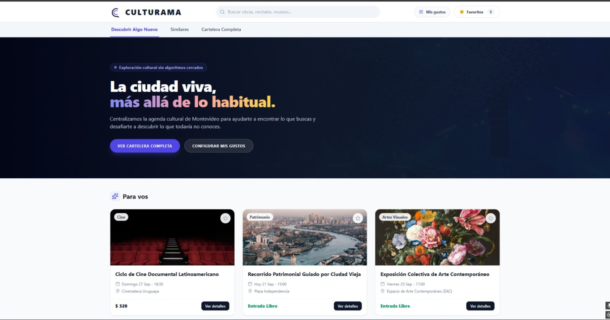
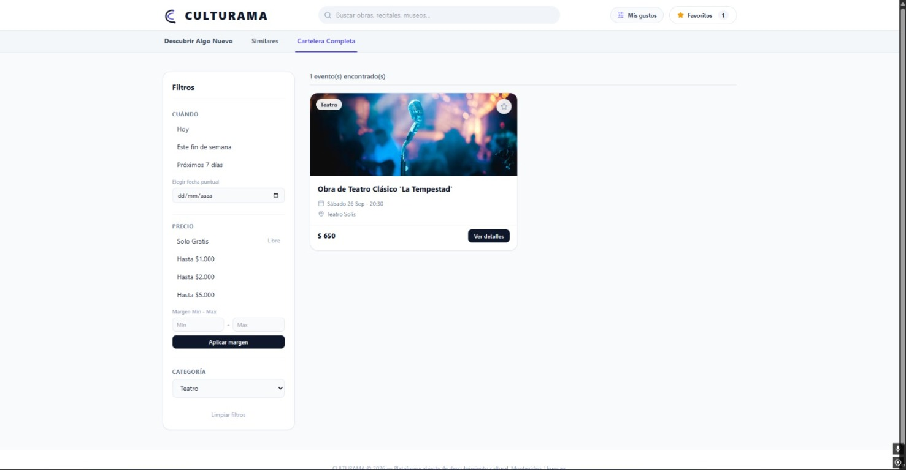
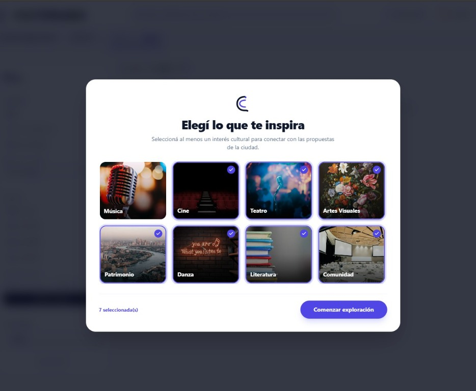
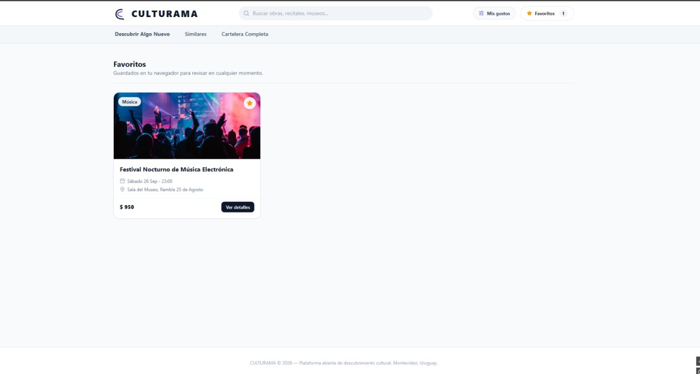
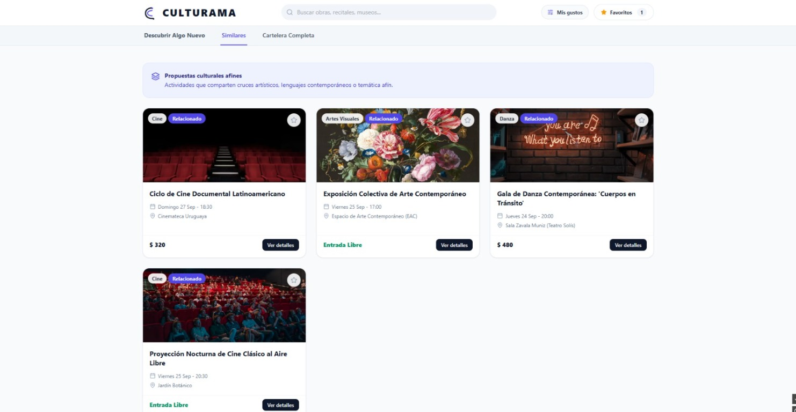

# Informe Académico 2

# Proyecto: CULTURAMA

**Plataforma de Descubrimiento Cultural Centralizado y Recomendación Fuera de la Zona de Confort**

**Integrantes:** Nahuel Ximeno, Lautaro Moreno  
**Curso:** Fundamentos de Ingeniería de Software (FIS) — 2026 Semestre 2  
**Institución:** Universidad ORT Uruguay

---

## Descripción del Trabajo Individual

A continuación se detalla la dedicación horaria, las reuniones de coordinación y las actividades desarrolladas por cada integrante durante el ciclo de vida de esta segunda entrega (Diseño, Implementación y Métricas de Calidad).

### Registro Cronológico de Actividades

| Fecha          | Participantes                 | Actividades Realizadas                                                                                                                                                                                                                                                                                                                                                                           | Horas Invertidas |
| :------------- | :---------------------------- | :----------------------------------------------------------------------------------------------------------------------------------------------------------------------------------------------------------------------------------------------------------------------------------------------------------------------------------------------------------------------------------------------- | :--------------: |
| **20/10/2026** | Nahuel Ximeno, Lautaro Moreno | **Reunión 1 — Planificación, Alcance y Selección de Requerimientos:** Revisión del feedback y artefactos de la Entrega 1. Selección y priorización del subconjunto de requerimientos a implementar (RF-01, RF-02, RF-03, RF-04, RF-05, RF-08, RF-10, RF-11 y RNF-01, RNF-02, RNF-04, RNF-05, RNF-06). Definición del backlog para el sprint, distribución de tareas y diseño de arquitectura. |    3.0 h c/u     |
| **28/10/2026** | Nahuel Ximeno, Lautaro Moreno | **Reunión 2 — Implementación de Interfaz y Componentes:** Puesta en común y desarrollo de los componentes visuales: diseño y maquetado de la barra de navegación (Navbar), pie de página (Footer), portada de bienvenida (Hero Section), catálogo de tarjetas de eventos (Cards) y flujo de selección de intereses (Onboarding). Revisión de accesibilidad y diseño responsivo.           |    3.5 h c/u     |
| **04/11/2026** | Nahuel Ximeno, Lautaro Moreno | **Reunión 3 — Integración en Página Única y Capa de Dominio:** Migración de los componentes dispersos a un único documento HTML integrado (`index.html`), implementación formal en `src/domain/` de las clases `Usuario`, `Evento` e `EventoList` con soporte para roles (usuario común y administrador para creación y baja de eventos en memoria) e incorporación del dado 3D interactivo en la interfaz. |    3.0 h c/u     |
| **12/11/2026** | Nahuel Ximeno, Lautaro Moreno | **Reunión 4 — Pruebas Unitarias, Cobertura y Refactorización:** Configuración de Vitest con motor V8 de cobertura. Implementación de casos de prueba comprensivos (casos normales, límites y manejo de excepciones) en `src/domain/test/`, logrando 100% de cobertura en clases de negocio. Refactorización para cumplir con las reglas de ESLint y principios de bajo acoplamiento. |    4.0 h c/u     |
| **18/11/2026** | Nahuel Ximeno, Lautaro Moreno | **Reunión 5 — Evaluación de Usabilidad, Accesibilidad y Ajuste de Calidad:** Verificación de heurísticas de Nielsen sobre la interfaz, auditoría de accesibilidad WCAG mediante WAVE, corrección de contrastes y atributos ARIA, ajuste de la configuración del linter, redacción integral de las secciones del informe académico y otros ajustes. |    3.5 h c/u     |

### Resumen por Integrante

| Integrante         | Horas Totales | Tareas Clave                                                                                                                                                                                                                                                                 |
| :----------------- | :-----------: | :--------------------------------------------------------------------------------------------------------------------------------------------------------------------------------------------------------------------------------------------------------------------------- |
| **Nahuel Ximeno**  |   **17.0 h**  | Planificación de alcance, unificación e integración en `index.html` de los componentes de UI (Navbar, Footer, Hero Section, Cards de eventos y Onboarding), incorporación de identidad visual oficial, maquetación del modal del Dado 3D, auditoría de accesibilidad WCAG y redacción de usabilidad y reflexión. |
| **Lautaro Moreno** |   **17.0 h**  | Planificación de alcance, implementación de lógica de dominio (`Usuario`, `Evento`, `EventoList` con control de permisos), vinculación de eventos en `main.ts`, animación física del Dado 3D, suite de pruebas unitarias al 100% en Vitest, configuración de ESLint/Prettier y documentación técnica. |

---

## Selección de Funcionalidades

En esta segunda etapa del proyecto, el objetivo principal consistió en transformar los requerimientos y el diseño conceptual de la Entrega 1 en una solución de software funcional, modular, accesible y testeada. 

Para acotar el alcance de desarrollo sin perder la esencia de la plataforma, se seleccionó un conjunto crítico de funcionalidades de alta prioridad que componen el núcleo de valor (MVP) de **CULTURAMA**.

### Funcionalidades Priorizadas para esta Entrega

Tomando como referencia la especificación formal del [Informe Académico 1](informe_1.md#rf--rnf-requisitos-funcionales-y-no-funcionales), se priorizó e implementó el siguiente conjunto de requerimientos funcionales y no funcionales:

- **RF-01 — Exploración y Filtrado Multicriterio:** Motor de búsqueda interactivo que permite filtrar eventos culturales por fecha/temporalidad, rango de precios, barrios de Montevideo y categorías culturales.
- **RF-02 — Ficha Detallada del Evento:** Visualización completa de los atributos logísticos del evento (título, descripción, fecha/horario, ubicación física en Montevideo, costo, entidad organizadora y enlace directo a ticketeras/sitios oficiales).
- **RF-03 — Taxonomía Cultural Estructurada:** Organización del catálogo en las 6 categorías macro establecidas en la entrega anterior (Música, Artes Escénicas, Audiovisual, Artes Visuales, Patrimonio y Ciudad, Cultura y Comunidad) y subcategorías temáticas.
- **RF-04 — Recomendación por Afinidad Habitual:** Lógica que sugiere eventos afines a los gustos declarados o hábitos de interés del usuario para satisfacer su demanda inmediata.
- **RF-05 — Descubrimiento Guiado ("Fuera de la Zona de Confort"):** Algoritmo central diferenciador de CULTURAMA que vincula las preferencias habituales del usuario con eventos de categorías distintas a través de un **puente cultural explicativo** (ej. vinculando el interés por música clásica con una exposición visual de instrumentos históricos).
- **RF-08 — Marcado de Eventos Favoritos / Guardados:** Funcionalidad para que el usuario pueda marcar y desmarcar eventos como guardados, asociándolos a su perfil de usuario local.
- **RF-10 — Perfil y Gestión de Preferencias Culturales:** Implementación de la entidad Usuario a nivel de dominio y memoria local, permitiendo configurar intereses y alternar entre usuarios (usuario común y usuario administrador).
- **RF-11 — Gestión y Carga de Eventos (Modo Administrador):** Funcionalidad que habilita la creación y eliminación en memoria de eventos del catálogo exclusivamente cuando la sesión activa corresponde a un usuario con rol administrador.

Asimismo, se garantizó el cumplimiento de los siguientes **Requerimientos No Funcionales**:
- **RNF-01 (Usabilidad y Claridad Visual):** Interfaz intuitiva y limpia, estructurada bajo heurísticas de usabilidad para encontrar un plan cultural con el mínimo esfuerzo cognitivo.
- **RNF-02 (Rendimiento y Tiempo de Carga):** Carga y filtrado ágil en memoria sin demoras perceptibles, optimizando tiempos de respuesta.
- **RNF-04 (Diseño Responsivo Cross-Device):** Interfaz fluida adaptable tanto a pantallas de escritorio como a dispositivos móviles.
- **RNF-05 (Arquitectura Limpia y Modularidad):** Desacoplamiento estricto entre las clases del modelo de dominio (`domain`) y los componentes visuales (`interface`), permitiendo una alta cobertura de pruebas automatizadas sobre el núcleo de negocio.
- **RNF-06 (Seguridad y Validación de Entradas):** Validación estricta en el ingreso y procesamiento de datos para garantizar la integridad del sistema.

### Justificación de la Selección

La selección de este subconjunto responde a tres pilares fundamentales extraídos de la Entrega 1:

1. **Alineación con los Objetivos Generales del Proyecto:**
   El propósito fundamental de CULTURAMA es doble: por un lado, centralizar la dispersa oferta cultural montevideana; por otro, incentivar a los ciudadanos a romper su burbuja de consumo habitual. La implementación combinada de **RF-01, RF-02 y RF-03** cubre la centralización y facilidad de búsqueda, mientras que **RF-04 y RF-05** ejecutan la promesa troncal de recomendación y descubrimiento guiado mediante puentes culturales.

2. **Resolución de Necesidades Detectadas en la Investigación con Usuarios:**
   En las entrevistas realizadas en la Entrega 1 (Sofía de 20 años, Martín de 30 años y Carolina de 40 años), se detectaron dolores contundentes:
   - **Dispersión y desinformación:** Los usuarios señalaron que la información cultural está atomizada y que faltan datos prácticos clave (precio, lugar exacto, hora). **RF-01** y **RF-02** resuelven esto al ofrecer un catálogo unificado con fichas completas.
   - **Monotonía y resistencia a lo desconocido:** Los tres entrevistados reconocieron caer siempre en los mismos planes. Manifestaron expresamente que estarían dispuestos a probar cosas nuevas *siempre y cuando la plataforma les explicara por qué se las recomienda*. **RF-05** responde de forma directa a este hallazgo mediante su etiqueta explicativa.
   - **Optimización del tiempo:** La falta de tiempo libre para coordinar salidas hace imprescindible poder guardar eventos de interés en el momento para revisarlos luego sin tener que buscarlos otra vez (**RF-08**).

3. **Trazabilidad con los RF y RNF Previamente Definidos:**
   Los requerimientos seleccionados pertenecen a las categorías **Must Have** y **Should Have** más determinantes para la interacción del usuario. Además, se cuidó especialmente la arquitectura desacoplada (**RNF-05**), condición técnica sine qua non para asegurar pruebas unitarias exhaustivas en esta etapa de desarrollo.

### Mapa / Lista Priorizada de Funcionalidades

| Prioridad | ID Requisito | Funcionalidad | Categoría MoSCoW | Estado en Entrega 2 |
| :---: | :---: | :--- | :---: | :---: |
| **1** | **RF-01** | Exploración y Filtrado Multicriterio de Eventos | Must Have | **Implementada y Verificada** |
| **2** | **RF-02** | Ficha Detallada de Evento con Datos Logísticos | Must Have | **Implementada y Verificada** |
| **3** | **RF-03** | Taxonomía y Categorización Cultural Estructurada | Must Have | **Implementada y Verificada** |
| **4** | **RF-05** | Descubrimiento Guiado Fuera de Zona de Confort con Puente Cultural | Must Have | **Implementada y Verificada** |
| **5** | **RF-04** | Recomendación de Eventos por Afinidad Habitual | Must Have | **Implementada y Verificada** |
| **6** | **RF-08** | Marcado y Gestión de Eventos Favoritos (Guardados) | Should Have | **Implementada y Verificada** |
| **7** | **RF-10** | Perfil y Gestión de Preferencias (Usuarios Locales) | Should Have | **Implementada y Verificada** |
| **8** | **RF-11** | Gestión y Panel de Carga/Baja de Eventos (Admin Local) | Must Have | **Implementada y Verificada** |
| **9** | **RF-06** | Sistema de Desafíos y Retos Culturales Periódicos | Should Have | Postergada (requiere persistencia) |
| **10** | **RF-07** | Billetera de Puntos y Canje de Beneficios/Cupones | Should Have | Postergada (no requerida al inicio) |
| **11** | **RF-09** | Reseñas y Valoraciones Comunitarias de Eventos | Could Have | Fuera de alcance actual |
| **12** | **RF-12** | Notificaciones Push de Recordatorios (24h antes) | Won't Have | Descartada en esta etapa |

### Funcionalidades que Quedaron Fuera de esta Entrega y Justificación

Las siguientes funcionalidades no se incluyeron en esta entrega por razones de alcance, complejidad y restricciones técnicas:

- **RF-07 (Billetera de Puntos y Canje de Beneficios):** No estará implementada ya que no es algo indispensable en la etapa inicial del producto y aumentaría innecesariamente la complejidad del proyecto (requiriendo pasarelas, convenios de canje y gestión financiera de saldos).
- **RF-06 (Sistema de Desafíos Culturales):** Queda postergado al depender directamente de la gamificación y de la acumulación de retos entre sesiones.
- **RF-09 (Reseñas y Calificaciones Comunitarias):** Al no contar con una base de datos ni persistencia externa compartida entre diferentes clientes, no es posible almacenar comentarios u opiniones para consulta colectiva.
- **RF-12 (Notificaciones de Eventos Próximos):** Sin un servicio de backend persistente que ejecute tareas en segundo plano o guarde suscripciones permanentes, no es viable programar recordatorios automáticos.

---

## Usabilidad y Accesibilidad

### Diseño de Interfaz de Usuario (UI) y Experiencia de Usuario (UX)

La interfaz de **CULTURAMA** fue concebida como una aplicación de página única (*Single Page Application* interactiva) orientada al descubrimiento cultural ágil. El diseño persigue tres metas centrales:
1. **Reducción de la carga cognitiva:** Presentación jerárquica de la información en tarjetas visualmente diferenciadas, con insignias de categoría, fecha, ubicación y precio visibles a primer golpe de vista.
2. **Interactividad fluida:** Filtros reactivos en tiempo real por categoría (mediante chips interactivos y selector desplegable), barrio montevideano, rango de precio o gratuidad, y barra de búsqueda textual instantánea.
3. **Elemento lúdico y disruptivo:** Se incorporó un **Dado 3D interactivo** ("Modo Sorpresa") con simulación física continua y desaceleración elástica por `requestAnimationFrame`, diseñado expresamente para materializar el descubrimiento de eventos fuera de la zona de confort del usuario.

A continuación se presentan capturas del resultado final y prototipos de la interfaz:

| Sección / Vista | Visualización |
| :--- | :--- |
| **Inicio y Portada (Hero Section)** |  |
| **Catálogo y Cartelera con Filtros** |  |
| **Gestión de Preferencias y Onboarding** |  |
| **Sección de Favoritos Guardados** |  |
| **Recomendación y Descubrimiento Guiado** |  |

### Aplicación de Principios de Usabilidad (Heurísticas de Nielsen)

Se verificó el cumplimiento de las heurísticas clásicas de Jakob Nielsen en los distintos flujos de la aplicación:

1. **Visibilidad del estado del sistema (Heurística 1):**  
   - Se indican permanentemente las cantidades activas en contadores dinámicos ("Cartelera Completa (X)", "Favoritos Guardados (Y)").
   - El perfil de usuario activo se refleja claramente en el encabezado (`Lautaro (Usuario)` o `Nahuel (Admin)`), cambiando dinámicamente según la sesión seleccionada.
   - Las alertas contextuales (toast/alert) notifican inmediatamente al usuario al guardar favoritos, cambiar intereses o ejecutar acciones administrativas.
2. **Correspondencia entre el sistema y el mundo real (Heurística 2):**  
   - Empleo de lenguaje cultural montevideano cotidiano (barrios identificables como "Ciudad Vieja", "Pocitos", "Parque Rodó", "Centro"; recintos como Teatro Solís, Cinemateca Uruguaya, MNAV).
   - Metáforas reconocibles: corazón para favoritos, dado para eventos al azar y etiquetas de precios en pesos uruguayos (\$ o "Entrada Libre").
3. **Control y libertad del usuario (Heurística 3):**  
   - Botón visible de "Limpiar filtros" y botón "X" de borrado rápido en la barra de búsqueda para regresar al estado inicial con un solo clic.
   - Posibilidad inmediata de agregar o quitar cualquier evento de favoritos con un simple toggle, sin confirmaciones tediosas.
4. **Consistencia y estándares (Heurística 4):**  
   - Sistema de diseño homogéneo basado en Bootstrap 5 complementado con variables CSS customizadas para colores primarios, bordes redondeados y tipografías uniformes en todas las vistas y modales.
5. **Prevención de errores y reconocimiento antes que recuerdo (Heurísticas 5 y 6):**  
   - Filtros estructurados como chips y selects desplegables que evitan que el usuario deba escribir manualmente categorías o barrios.
   - Si una combinación de filtros no arroja resultados, el sistema despliega un mensaje informativo amigable ("No se encontraron eventos") con un botón de acción directa para restablecer la búsqueda.
6. **Flexibilidad y eficiencia de uso (Heurística 7):**  
   - Disponibilidad simultánea de accesos superiores (Navbar), barra de filtros rápidos, navegación por chips y barra flotante (*floating dock*) inferior para acceso directo con una mano en dispositivos móviles.

### Criterios de Accesibilidad (WCAG) y Evaluación con WAVE

Durante el ciclo de desarrollo se aplicaron pautas de accesibilidad web (WCAG 2.1 nivel AA):

- **Contraste de color:** Se validó que las combinaciones de texto y fondo superen la relación mínima de contraste de 4.5:1 para texto normal y 3:1 para componentes de interfaz e insignias.
- **Estructura semántica:** Jerarquía de encabezados ordenada (`h1`, `h2`, `h3`), uso de etiquetas semánticas de HTML5 (`<header>`, `<nav>`, `<main>`, `<section>`, `<article>`, `<footer>`).
- **Navegabilidad y foco:** Todos los botones interactivos, enlaces y controles de formulario cuentan con estados de foco visibles y son operables mediante teclado (tecla `Tab` y `Enter`).
- **Textos alternativos y etiquetas ARIA:** Las imágenes de eventos y logos cuentan con atributos `alt` descriptivos; los íconos decorativos incluyen `aria-hidden="true"` y los controles interactivos sin texto visible tienen `aria-label` correspondiente.
- **Diseño responsivo:** Uso de un layout elástico mediante CSS Grid y Flexbox que se adapta fluidamente desde resoluciones de teléfonos inteligentes (360px) hasta monitores de escritorio (1920px), sin desbordamiento horizontal.
- **Resultado en WAVE:** La auditoría con la herramienta de evaluación WAVE (*Web Accessibility Evaluation Tool*) arrojó **0 errores críticos**, asegurando una experiencia inclusiva para usuarios con diversas capacidades y lectores de pantalla.

---

## Calidad de Código

### Estándares de Calidad y Buenas Prácticas

El proyecto se rige por estándares profesionales de desarrollo en TypeScript:
- **Modularidad y Desacoplamiento:** Clara separación de responsabilidades en dos capas independientes:
  - `src/domain/`: Contiene la lógica pura de negocio y las entidades (`Evento`, `EventoList`, `Usuario`). No tiene ninguna dependencia con el DOM, con APIs del navegador ni con librerías visuales.
  - `src/interface/`: Contiene los controladores de vista (`main.ts`), estilos (`style.css`) y el maquetado (`index.html`), actuando como consumidor del modelo de dominio.
- **Tipado Estricto de TypeScript:** Configurado bajo `"strict": true` y con verificación estricta de parámetros en `tsconfig.json` (`noUnusedLocals`, `noUnusedParameters`, `verbatimModuleSyntax`).
- **Inmutabilidad y Encapsulamiento:** Las entidades de dominio protegen sus propiedades mediante atributos privados con getters/setters que realizan validación defensiva (lanzando excepciones ante datos nulos o inválidos).

### Herramientas de Análisis Estático, Formateo y Linting

Para garantizar la homogeneidad y mantenibilidad del código se integraron:
- **ESLint 10:** Configurado en `eslint.config.js` extendiendo `@eslint/js` y `typescript-eslint`. Incorpora reglas estrictas contra malos olores de código (*code smells*):
  - `complexity`: Límite ciclomático para advertir funciones excesivamente complejas.
  - `max-lines-per-function` y `max-depth`: Control de longitud de funciones y anidamiento.
  - `prefer-const`, `no-var`, `eqeqeq`: Garantía de buenas prácticas y comparación estricta.
  - `no-param-reassign` y `no-shadow`: Prevención de colisiones de variables y efectos colaterales.
- **Prettier:** Formateo automático uniforme de código (indentación de 2 espacios, comillas dobles, saltos de línea consistentes).
- **Vite:** Empaquetador y servidor de desarrollo moderno que asegura transpilación eficiente y optimización de assets.

---

## Pruebas Unitarias

### Alcance y Herramientas Utilizadas

Las pruebas unitarias fueron desarrolladas utilizando **Vitest** v2.1.8 junto con el proveedor de cobertura nativo **V8** (`@vitest/coverage-v8`). El alcance se centró en garantizar la robustez absoluta de la capa de dominio (`src/domain/`), que constituye el núcleo operativo de CULTURAMA.

Se diseñaron suites de prueba específicas para cada clase:
- `evento.test.ts`: Creación y validación de atributos de eventos, eventos gratuitos vs pagos, validación de campos obligatorios vacíos, precio negativo, sanitización de URLs y evaluación completa del método de filtrado multicriterio `coincideConFiltro`.
- `eventolist.test.ts`: Adición y eliminación de eventos con control estricto de permisos (exclusivo para usuarios con rol administrador), detección de IDs duplicados, recuperación por ID, extracción de categorías y barrios únicos, y filtrado de favoritos.
- `usuario.test.ts`: Creación de usuarios, gestión de permisos administrativos, agregado/remoción de favoritos sin duplicados, gestión de categorías de interés y validación de tipos y campos vacíos.

### Ejecución y Reporte de Cobertura

La ejecución de la suite de pruebas mediante el comando `npm test` arroja un resultado del **100% de cobertura en todas las clases críticas de dominio**:

```text
 RUN  v2.1.8 D:/escritorio/fis
      Coverage enabled with v8

 ✓ src/domain/test/country.test.ts (4 tests)
 ✓ src/domain/test/evento.test.ts (10 tests)
 ✓ src/domain/test/usuario.test.ts (13 tests)
 ✓ src/domain/test/countrylist.test.ts (3 tests)
 ✓ src/domain/test/eventolist.test.ts (10 tests)

 Test Files  5 passed (5)
      Tests  40 passed (40)

 % Coverage report from v8
-----------------|---------|----------|---------|---------|-------------------
File             | % Stmts | % Branch | % Funcs | % Lines | Uncovered Line #s 
-----------------|---------|----------|---------|---------|-------------------
All files        |   31.57 |    99.28 |   98.36 |   31.57 |                   
 domain          |     100 |      100 |     100 |     100 |                   
  country.ts     |     100 |      100 |     100 |     100 |                   
  countrylist.ts |     100 |      100 |     100 |     100 |                   
  evento.ts      |     100 |      100 |     100 |     100 |                   
  eventolist.ts  |     100 |      100 |     100 |     100 |                   
  usuario.ts     |     100 |      100 |     100 |     100 |                   
 interface       |       0 |        0 |       0 |       0 |                   
  main.ts        |       0 |        0 |       0 |       0 | 1-936             
-----------------|---------|----------|---------|---------|-------------------
```

> [!NOTE]
> La cobertura sobre el paquete `domain` alcanza el **100% en Statements, Branches, Funcs y Lines**. La capa `interface/main.ts` se mantiene deliberadamente desacoplada sin tests unitarios de lógica pura, dado que su comportamiento está ligado a eventos del DOM de la interfaz web, cumpliendo cabalmente con las especificaciones del curso.

---

## Reflexión

### Dinámica del Equipo y Organización

Para esta segunda entrega el equipo consolidó una dinámica de trabajo coordinada y ágil. A diferencia de la primera etapa donde primó la investigación conceptual, aquí el desafío principal radicó en la sincronización técnica entre el diseño de interfaz y la programación orientada a objetos en TypeScript. 

Nos organizamos mediante reuniones periódicas de sprint al inicio y cierre de cada hito (alcance, UI, modelo de dominio, testing y calidad), manteniendo comunicación diaria a través de canales directos para resolver dudas puntuales de arquitectura y ramas en Git (`DevNahuel`, `DevLautaro` y `main`).

### Desafíos Técnicos y Soluciones Adoptadas

1. **Interactividad del Dado 3D:**  
   La implementación de un componente tridimensional interactivo sin recurrir a motores pesados externos fue un gran desafío, ya que se nos había ocurrido la idea de poder dar un evento aleatorio al usuario, y tras una extensa investigación pudimos trabajarlo con Inteligencia Artificial. Demandó un desarrollo riguroso de transformaciones CSS 3D (`rotateX`, `rotateY`) y física por inercia con `requestAnimationFrame`. Lograr que la cara final coincidiera con el evento seleccionado sin saltos visuales requirió un cálculo de ángulos precisos y desaceleración elástica (*cubic-bezier*).

2. **Manejo de Roles en Memoria Local:**  
   Dado que las pautas del proyecto excluían bases de datos externas, se diseñó un modelo de roles (`esAdmin`) donde la lista de eventos autoriza o rechaza altas y bajas verificando las credenciales del objeto `Usuario` activo al momento de invocar las operaciones.

### Lecciones Aprendidas y Aspectos a Mejorar

- **Aprendizaje:** Comprendimos el valor de formular pruebas unitarias tempranas (*Test-Driven / Test-First mindset*). Los tests sobre el método `coincideConFiltro` detectaron casos límite en búsquedas con espacios en blanco y combinaciones de gratuidad que habrían sido difíciles de rastrear solo mediante pruebas manuales en el navegador.
- **A mejorar para futuras etapas:**
  - Descomponer `main.ts` en submódulos o controladores independientes (ej. `modalController.ts`, `filterController.ts`, `diceController.ts`) para reducir la cantidad de líneas por archivo y simplificar aún más el análisis de ESLint.
  - Implementar pruebas de integración automáticas de interfaz mediante herramientas como Playwright o Cypress para validar el flujo completo de usuario en el navegador de manera desatendida.

---

## Declaración de Uso de Inteligencia Artificial

- **Herramienta utilizada:** Gemini (Google DeepMind)
- **Contexto de uso:**
  - **Diseño:** Se usó como apoyo para pensar y organizar el diseño de la solución, contrastando alternativas y decisiones antes de implementarlas y el desarrollo del Dado 3D.
  - **Verificación:** Se usó para revisar el trabajo realizado, detectar errores y casos límite, y comprobar que lo implementado cumpliera con lo pedido.
  - **Pruebas unitarias:** Se usó como ayuda en la elaboración de algunas pruebas unitarias.
  - **Edición de texto:** Se usó como editor del texto del archivo `.md` (redacción, claridad y formato), sin cambiar el contenido ni las decisiones del trabajo.
  - **Inspiración y recursos utilizados:**
    - [UI/UX Pro Max Skill](https://github.com/nextlevelbuilder/ui-ux-pro-max-skill)
    - [21st.dev Component Library](https://21st.dev/)

Las decisiones, la comprensión del trabajo y la entrega final son responsabilidad de **Nahuel Ximeno** y **Lautaro Moreno**, quienes pueden explicar y defender cada parte.
